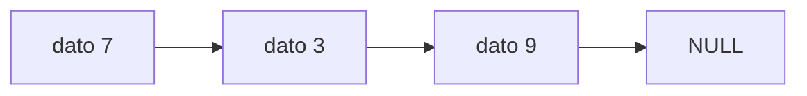

# Informe del avance

*(Borren los comentarios entre paréntesis al escribir.)*

## 1. El escenario

Nuestro escenario corresponde al inventario de una tienda, el cual puede ser usado por el encargado para poder llevar un control de manera correcta sobre sus productos.
La informacion que este maneja y guarda es: un código único que identifica a cada producto para que no se confunda con algún otro, el nombre del artículo y por último la cantidad que haya de ese producto. 

Este inventario resuelve muchas situaciones que serían complicadas de afrontar si en la tienda no se tiene una herramienta que permita llevar el control de los articulos disponibles en esta. Por ejemplo, cuando llega mercancía nueva, se agota un producto o un cliente pregunta si hay existencias de alguno, entre muchas otras.

El programa se comunica de manera que el usuario le otorga unas ordenes, en donde debe colocar unos parametros específicos y este responde con algunos textos de acuerdo a lo que se le haya pedido. Los detalles estan en el siguiente numeral. 

## 2. Qué guarda la estructura y qué operaciones necesita

| Operación | Qué hace | Precondición |
|---|---|---|
| Agregar (id, nombre, cantidad) | Añade un producto al inventario, con su id, nombre y cantidad. Responde “ok” si se añadió, o “repetido” si el artículo ya estaba. | Ninguna sobre el inventario. Que el código ya exista no impide ejecutarla: es un resultado que se informa. |
| Eliminar (id) | Quita el artículo con ese id del inventario. Responde “ok” si se eliminó, o “no existe” si no estaba. | Ninguna. Funciona también con el inventario vacío, y responde “no existe”. |
| Consultar (id) | Muestra el artículo con ese id: responde con su id, nombre y cantidad, o con “no existe” si no está. No modifica nada. | Ninguna. |
| Reponer (id, cantidad) | Aumenta la cantidad de un artículo que ya está en el inventario. Responde “ok” si se repuso, o “no existe” si el artículo no está. | Que el articulo no esté en el inventario. |
| Listar |Muestra todos los artículos del inventario, uno por línea. No modifica nada.  | Ninguna. Con el inventario vacío no muestra nada. |

## 3. La estructura escogida y por qué

(Por qué esa y no la otra, en términos del orden en que entran y salen
los elementos y de lo que cuesta cada operación. Citen el texto guía:
Thareja capítulo X, o CLRS 4.ª ed. capítulo Y.)

Costos esperados, con $n$ el número de elementos:

| Operación | Tiempo | Espacio |
|---|---|---|
|  | $O(1)$ | $O(1)$ |

El invariante de la estructura, como fórmula:

$$I:\quad 0 \leq n \leq \text{capacidad}$$

Un diagrama del estado de la estructura, en Mermaid:

## 4. Qué piensan medir

(Qué entrada van a variar, entre qué tamaños, y qué esperan ver.)

## 5. Casos de prueba

| Caso | Entrada | Salida esperada | Salida obtenida |
|---|---|---|---|
| funcional 1 |  |  |  |
| funcional 2 |  |  |  |
| funcional 3 |  |  |  |
| límite |  |  |  |

(El caso límite es la estructura vacía, con un solo elemento, llena, o
con la clave repetida: digan cuál escogieron y por qué.)
