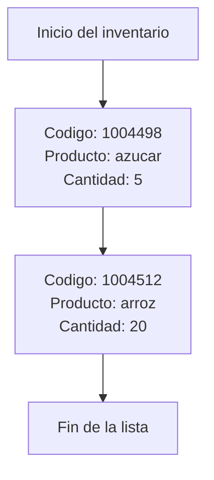

# Informe del avance

*(Borren los comentarios entre paréntesis al escribir.)*

## 1. El escenario

Nuestro escenario corresponde al inventario de una tienda, el cual puede ser usado por el encargado para poder llevar un control de manera correcta sobre sus productos.
La informacion que este maneja y guarda es: un código único que identifica a cada producto para que no se confunda con algún otro, el nombre del artículo y por último la cantidad que haya de ese producto. 

Este inventario resuelve muchas situaciones que serían complicadas de afrontar si en la tienda no se tiene una herramienta que permita llevar el control de los articulos disponibles en esta. Por ejemplo, cuando llega mercancía nueva, se agota un producto o un cliente pregunta si hay existencias de alguno, entre muchas otras.

El programa se comunica de manera que el usuario le otorga unas ordenes, en donde debe colocar unos parametros específicos y este responde con algunos textos de acuerdo a lo que se le haya pedido. Los detalles estan en el siguiente numeral. 

## 2. Qué guarda la estructura y qué operaciones necesita

| Operación | Qué hace | Precondición |
|---|---|---|
| Agregar (id, nombre, cantidad) | Añade un producto al inventario, con su id, nombre y cantidad. Responde “ok” si se añadió, o “repetido” si el artículo ya estaba. | $\text{id} > 0$; nombre no vacío, sin espacios, de a lo sumo 63 caracteres; $\text{cantidad} > 0$	Son los datos que la estructura sabe guardar: el nombre cabe en char nombre[64] |
| Eliminar (id) | Quita el artículo con ese id del inventario. Responde “ok” si se eliminó, o “no existe” si no estaba. | Lista no vacia e $\text{id} > 0$, ya que con la lista vacía no hay nada que quitar.  |
| Consultar (id) | Muestra el artículo con ese id: responde con su id, nombre y cantidad, o con “no existe” si no está. No modifica nada. | Lista no vacia e $\text{id} > 0$, |
| Reponer (id, cantidad) | Aumenta la cantidad de un artículo que ya está en el inventario. Responde “ok” si se repuso, o “no existe” si el artículo no está. | Lista no vacia, $\text{id} > 0$ y cantidad positiva ($\text{cantidad} > 0$), puesto que con cantidad negativa “reponer” restaría existencias |
| Listar |Muestra todos los artículos del inventario, uno por línea. No modifica nada.  | Ninguna. Con el inventario vacío no muestra nada. |

Si una precondición no se cumple, la estructura no se modifica. Por ejemplo, con el inventario vacío (`ELIMINAR`, `CONSULTAR` o `REPONER`), el programa responde `no existe`, como fija el enunciado; y un `AGREGAR` con datos fuera de dominio se ignora sin escribir nada.

## 3. La estructura escogida y por qué

**Borrador de Paula para revisión del grupo.** Los costos deberán contrastarse
con la implementación cuando esté terminada.

Para el avance se utiliza una lista enlazada simple, como pide el escenario A.
Cada nodo contiene un producto (código, nombre y cantidad) y un puntero al
siguiente nodo. El inventario conserva un puntero al primero, llamado `cabeza`.
No se usa un contenedor de la biblioteca para guardar los nodos.

El inventario necesita consultar y eliminar productos en cualquier posición.
Una pila o una cola se organiza alrededor de sus extremos, por lo que no
representa directamente esas operaciones. Frente a un arreglo, la lista
permite reservar nodos conforme se necesitan y eliminar un producto ajustando
enlaces, sin desplazar los siguientes. A cambio, guarda un puntero adicional
por nodo y necesita recorrer la lista para encontrar un código.

La búsqueda lineal revisa desde `cabeza` hasta encontrar el código o alcanzar
`nullptr`. `consultar` reutiliza esa búsqueda y copia el producto de salida;
`reponer` reutiliza la misma búsqueda y suma a la cantidad existente. Una
reposición de un código ausente devuelve fallo y no crea un producto.

Se propone insertar los nuevos productos al principio. Con esa decisión,
`listar` recorrería los productos presentes en orden inverso al de inserción.
Eliminar un producto ajustaría los enlaces sin cambiar el orden relativo de
los demás. Esta decisión debe confirmarse con el grupo antes de implementar.

Costos esperados en el peor caso, con $n\geq1$ productos, nombres de longitud
acotada y operaciones sobre enteros de costo constante. El espacio auxiliar
excluye los nodos ya almacenados y la salida del programa.

| Operación | Tiempo | Espacio auxiliar | Justificación |
|---|---|---|---|
| Buscar | $O(n)$ | $O(1)$ | Puede revisar todos los nodos antes de encontrar el código o llegar al final. |
| Agregar | $O(n)$ | $O(1)$ | Busca para detectar repetidos; después enlaza al principio y reserva un nodo adicional de tamaño acotado. |
| Consultar | $O(n)$ | $O(1)$ | Busca el código y recupera el producto encontrado. |
| Reponer | $O(n)$ | $O(1)$ | Busca el código y luego suma la cantidad recibida. |
| Eliminar | $O(n)$ | $O(1)$ | Localiza el nodo y su anterior; después ajusta enlaces y libera el nodo. |
| Listar | $O(n)$ | $O(1)$ | Recorre e imprime todos los productos. |

En una lista vacía estas operaciones tienen costo constante, $O(1)$.
Encontrar el producto en el primer nodo también es constante; en el peor
caso hay que recorrer toda la lista. Bajo la hipótesis de nombres de longitud
acotada, la memoria de los productos y sus enlaces crece proporcionalmente
al número de nodos, $O(n)$ para una lista no vacía. Destruir la lista requiere
recorrer y liberar todos sus nodos. Si los nombres pueden crecer sin límite,
también hay que contar la memoria y el tiempo necesarios para guardarlos,
copiarlos e imprimirlos.

El **invariante** es el conjunto de condiciones que debe mantenerse después
de agregar, eliminar o reponer un producto:

- Una lista vacía tiene `cabeza` igual a `nullptr`; si no está vacía,
  `cabeza` apunta al primer nodo.
- Los códigos de los productos no se repiten.
- Los nodos forman una cadena sin ciclos y el último apunta a `nullptr`.

Para escribir estas condiciones como fórmulas, sea $n$ el número de nodos,
$v_i$ el nodo en la posición $i$ y $c_i$ su código.

Estado vacío y primer nodo:

$$
n \in \mathbb{N}_0 \quad\land\quad (n=0 \iff \mathrm{cabeza}=\mathrm{nullptr}) \quad\land\quad (n>0 \Rightarrow \mathrm{cabeza}=v_0).
$$

Nodos distintos y códigos únicos:

$$
\forall i,j \in \{0,\ldots,n-1\},\quad i\ne j \Rightarrow (v_i\ne v_j \land c_i\ne c_j).
$$

Enlaces de la cadena y final de la lista:

$$
\forall i\in\mathbb{Z},\quad 0\le i<n-1 \Rightarrow v_i.\mathrm{siguiente}=v_{i+1}.
$$

$$
n>0 \Rightarrow v_{n-1}.\mathrm{siguiente}=\mathrm{nullptr}.
$$

No se supone una capacidad fija de la lista.

Ejemplo del estado propuesto después de agregar arroz y luego azúcar:



Cada caja de producto representa un nodo y cada flecha su enlace al siguiente.
“Fin de la lista” indica que no hay otro producto; no es un nodo adicional.

Referencia para estudiar y contrastar: Cormen, Leiserson, Rivest y Stein,
*Introduction to Algorithms*, 4.ª edición, MIT Press, 2022, capítulo 10,
sección 10.2, “Linked lists”; para cotas asintóticas, capítulo 3, sección 3.2.
La sección 10.2 trata listas enlazadas, incluidas variantes; el análisis
anterior se aplica específicamente a nuestra propuesta de lista simple.
El [índice oficial](https://mitp-content-server.mit.edu/books/content/sectbyfn/books_pres_0/11599/4e_toc.pdf)
permite verificar la numeración; no sustituye la lectura del capítulo.
**Pendiente:** confirmar que esta es la edición del texto guía que utilizará el grupo.

Sesión del 22 de octubre de 2026, para revisar
los requisitos y proponer un borrador de explicación y costos. Paula y el grupo deben revisar el contenido y contrastarlo con el texto guía y con su
implementación.

Sesión del 27 de octubre de 2026, para
proponer una primera versión de `buscar`, `consultar` y `reponer`
(`codigo/lista_busqueda.cpp`), del caso funcional 2 y de un banco local de
pruebas. Paula revisó el código y lo contrastó con las restricciones del
enunciado.

## 4. Qué piensan medir

(Qué entrada van a variar, entre qué tamaños, y qué esperan ver.)

## 5. Casos de prueba

Las pruebas representan situaciones del inventario de una tienda. Cada caso
empieza con un inventario vacío y se ejecuta de forma independiente. La
primera línea de la entrada indica cuántas órdenes se deben procesar.
Los nombres de productos se escriben sin espacios, como exige el escenario.
El caso 1 supone la inserción al principio propuesta en la sección 3.

| Caso | Situación de la tienda | Archivos de entrada y salida esperada | Salida obtenida con el programa del grupo |
|---|---|---|---|
| Funcional 1 | Registrar productos, listar existencias y rechazar un código repetido. | `agregar_listar.in` y `agregar_listar.out`, en `datos/`. | Pendiente de ejecutar cuando esté implementado el programa completo. |
| Funcional 2 | Consultar existencias y sumar mercancía recibida; verificar códigos ausentes. | `consultar_reponer.in` y `consultar_reponer.out`, en `datos/`. | Pendiente con el programa completo. El banco auxiliar produjo la salida esperada; el detalle aparece debajo del caso. |
| Funcional 3 | Retirar productos del inventario y comprobar que ya no se pueden consultar. | `eliminar_productos.in` y `eliminar_productos.out`, en `datos/`. | Pendiente de ejecutar cuando esté implementado el programa completo. |
| Límite | Consultar, reponer, eliminar y listar cuando la tienda todavía no tiene productos registrados. | `inventario_vacio.in` y `inventario_vacio.out`, en `datos/`. | Pendiente de ejecutar cuando esté implementado el programa completo. |

### Caso funcional 1: registrar y listar productos

Se registran arroz y leche. Después se intenta registrar otra vez el código
del arroz, con una cantidad diferente. El inventario debe rechazar el
repetido y conservar las 20 unidades originales.

**Entrada:**

```text
5
AGREGAR 101 arroz 20
AGREGAR 102 leche 6
LISTAR
AGREGAR 101 arroz 99
CONSULTAR 101
```

**Salida esperada:**

```text
ok
ok
102 leche 6
101 arroz 20
repetido
101 arroz 20
```

**Salida obtenida:** pendiente de ejecutar con el programa completo. `LISTAR`
produce dos líneas; por eso la salida tiene más líneas que órdenes.

### Caso funcional 2: consultar y reponer existencias

Se registran arroz, azúcar y sal. Se consultan sus existencias, se suma la
mercancía recibida y se consulta de nuevo para verificar el aumento.
También se usa un código inexistente: la reposición debe informar el fallo
y no crear un producto nuevo.

**Entrada:**

```text
15
AGREGAR 1004512 arroz 20
AGREGAR 1004498 azucar 5
AGREGAR 300 sal 7
CONSULTAR 1004512
CONSULTAR 1004498
CONSULTAR 300
REPONER 1004498 10
CONSULTAR 1004498
REPONER 1004512 4
CONSULTAR 1004512
REPONER 300 2
CONSULTAR 300
CONSULTAR 999
REPONER 999 3
CONSULTAR 999
```

**Salida esperada:**

```text
ok
ok
ok
1004512 arroz 20
1004498 azucar 5
300 sal 7
ok
1004498 azucar 15
ok
1004512 arroz 24
ok
300 sal 9
no existe
no existe
no existe
```

**Salida obtenida:** corrida con un banco auxiliar local, que une
`buscar`, `consultar` y `reponer` (`codigo/lista_busqueda.cpp`) con piezas
provisionales de `agregar`, `listar` y `eliminar`. La salida fue idéntica a
la esperada (15 líneas, comparadas con `diff`) y la corrida con
`-fsanitize=address,undefined` no reportó errores:

```text
ok
ok
ok
1004512 arroz 20
1004498 azucar 5
300 sal 7
ok
1004498 azucar 15
ok
1004512 arroz 24
ok
300 sal 9
no existe
no existe
no existe
```

Esta corrida no sustituye la del programa completo: cuando estén las piezas
de `lista.h` y `principal.cpp`, se debe ejecutar `make pruebas` y registrar
aquí la salida de ese programa.


### Caso funcional 3: eliminar productos

Se registran tres productos. Con inserción al principio, se elimina primero
la leche de la posición intermedia, después el pan del inicio y por último
el arroz, que queda como único producto. Las consultas deben confirmar cada
eliminación. Un segundo intento de eliminar el arroz debe responder que no
existe.

**Entrada:**

```text
12
AGREGAR 10 arroz 3
AGREGAR 20 leche 4
AGREGAR 30 pan 5
ELIMINAR 20
CONSULTAR 20
ELIMINAR 30
CONSULTAR 30
ELIMINAR 10
CONSULTAR 10
ELIMINAR 10
LISTAR
CONSULTAR 999
```

**Salida esperada:**

```text
ok
ok
ok
ok
no existe
ok
no existe
ok
no existe
no existe
no existe
```

**Salida obtenida:** pendiente de ejecutar con el programa completo. El
`LISTAR` de este caso no produce ninguna línea porque ya no quedan productos.

### Caso límite: inventario vacío

Este caso comprueba el comportamiento antes de registrar el primer producto.
Consultar, reponer o eliminar un código ausente debe responder `no existe`.
Listar un inventario vacío no imprime productos ni mensajes adicionales.

**Entrada:**

```text
5
LISTAR
CONSULTAR 999
REPONER 999 4
ELIMINAR 999
LISTAR
```

**Salida esperada:**

```text
no existe
no existe
no existe
```

**Salida obtenida:** pendiente de ejecutar con el programa completo. Las dos
órdenes `LISTAR` no producen líneas en la salida.

Las entradas y salidas esperadas ya están preparadas como archivos de texto.
Cuando el grupo implemente todas las operaciones, debe ejecutar `make pruebas`
y registrar las salidas reales antes de entregar. No se considera ejecutada
una prueba por haber escrito su salida esperada.
