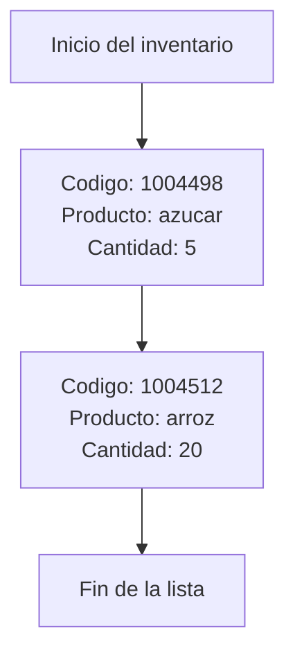

# Informe del avance


## 1. El escenario

Nuestro escenario corresponde al inventario de una tienda, el cual puede ser usado por el encargado para poder llevar un control de manera correcta sobre sus productos.
La informacion que este maneja y guarda es: un código único que identifica a cada producto para que no se confunda con algún otro, el nombre del artículo y por último la cantidad que haya de ese producto. 

Este inventario resuelve muchas situaciones que serían complicadas de afrontar si en la tienda no se tiene una herramienta que permita llevar el control de los articulos disponibles en esta. Por ejemplo, cuando llega mercancía nueva, se agota un producto o un cliente pregunta si hay existencias de alguno, entre muchas otras.

El programa se comunica de manera que el usuario le otorga unas ordenes, en donde debe colocar unos parametros específicos y este responde con algunos textos de acuerdo a lo que se le haya pedido. Los detalles estan en el siguiente numeral. 

## 2. Qué guarda la estructura y qué operaciones necesita

| Operación | Qué hace | Precondición |
|---|---|---|
| Agregar (id, nombre, cantidad) | Añade un producto al inventario, con su id, nombre y cantidad. Responde “ok” si se añadió, o “repetido” si el artículo ya estaba. | $\text{id} > 0$; nombre no vacío, sin espacios, de a lo sumo 63 caracteres (cabe en `char nombre[64]`); $\text{cantidad} > 0$ |
| Eliminar (id) | Quita el artículo con ese id del inventario. Responde “ok” si se eliminó, o “no existe” si no estaba. | Lista no vacia e $\text{id} > 0$, ya que con la lista vacía no hay nada que quitar.  |
| Consultar (id) | Muestra el artículo con ese id: responde con su id, nombre y cantidad, o con “no existe” si no está. No modifica nada. | Lista no vacia e $\text{id} > 0$, |
| Reponer (id, cantidad) | Aumenta la cantidad de un artículo que ya está en el inventario. Responde “ok” si se repuso, o “no existe” si el artículo no está. | Lista no vacia, $\text{id} > 0$ y cantidad positiva ($\text{cantidad} > 0$), puesto que con cantidad negativa “reponer” restaría existencias |
| Listar |Muestra todos los artículos del inventario, uno por línea. No modifica nada.  | Ninguna. Con el inventario vacío no muestra nada. |

Si una precondición no se cumple, la estructura no se modifica. Por ejemplo, con el inventario vacío (`ELIMINAR`, `CONSULTAR` o `REPONER`), el programa responde `no existe`, como fija el enunciado; y un `AGREGAR` con datos fuera de dominio se ignora sin escribir nada.

## 3. La estructura escogida y por qué

Para el avance se utiliza una lista enlazada simple, como pide el escenario A.
Cada nodo contiene un producto (código, nombre y cantidad) y un puntero al
siguiente nodo. El inventario conserva un puntero al primero, llamado `cabeza`.
No se usa un contenedor de la biblioteca para guardar los nodos.

El inventario necesita consultar y eliminar productos en cualquier posición.
Una pila o una cola se organiza alrededor de sus extremos, por lo que no
representa directamente esas operaciones. Frente a un arreglo, la lista
permite reservar nodos conforme se necesitan y eliminar un producto ajustando
enlaces, sin desplazar los siguientes. A cambio, guarda un puntero adicional
por nodo y necesita recorrer la lista para encontrar un código.

La búsqueda lineal revisa desde `cabeza` hasta encontrar el código o alcanzar
`nullptr`. `consultar` reutiliza esa búsqueda y copia el producto de salida;
`reponer` reutiliza la misma búsqueda y suma a la cantidad existente. Una
reposición de un código ausente devuelve fallo y no crea un producto.

Los nuevos productos se insertan al principio. Por eso `listar` recorre los
productos presentes en orden inverso al de inserción. Eliminar un producto
ajusta los enlaces sin cambiar el orden relativo de los demás.

Costos esperados en el peor caso, con $n\geq1$ productos, nombres de longitud
acotada y operaciones sobre enteros de costo constante. El espacio auxiliar
excluye los nodos ya almacenados y la salida del programa.

| Operación | Tiempo | Espacio auxiliar | Justificación |
|---|---|---|---|
| Buscar | $O(n)$ | $O(1)$ | Puede revisar todos los nodos antes de encontrar el código o llegar al final. |
| Agregar | $O(n)$ | $O(1)$ | Busca para detectar repetidos; después enlaza al principio y reserva un nodo adicional de tamaño acotado. |
| Consultar | $O(n)$ | $O(1)$ | Busca el código y recupera el producto encontrado. |
| Reponer | $O(n)$ | $O(1)$ | Busca el código y luego suma la cantidad recibida. |
| Eliminar | $O(n)$ | $O(1)$ | Localiza el nodo y su anterior; después ajusta enlaces y libera el nodo. |
| Listar | $O(n)$ | $O(1)$ | Recorre e imprime todos los productos. |

En una lista vacía estas operaciones tienen costo constante, $O(1)$.
Encontrar el producto en el primer nodo también es constante; en el peor
caso hay que recorrer toda la lista. Bajo la hipótesis de nombres de longitud
acotada, la memoria de los productos y sus enlaces crece proporcionalmente
al número de nodos, $O(n)$ para una lista no vacía. Destruir la lista requiere
recorrer y liberar todos sus nodos. Si los nombres pueden crecer sin límite,
también hay que contar la memoria y el tiempo necesarios para guardarlos,
copiarlos e imprimirlos.

El **invariante** es el conjunto de condiciones que debe mantenerse después
de agregar, eliminar o reponer un producto:

- Una lista vacía tiene `cabeza` igual a `nullptr`; si no está vacía,
  `cabeza` apunta al primer nodo.
- Los códigos de los productos no se repiten.
- Los nodos forman una cadena sin ciclos y el último apunta a `nullptr`.

Para escribir estas condiciones como fórmulas, sea $n$ el número de nodos,
$v_i$ el nodo en la posición $i$ y $c_i$ su código.

Estado vacío y primer nodo:

$$
n \in \mathbb{N}_0 \quad\land\quad (n=0 \iff \mathrm{cabeza}=\mathrm{nullptr}) \quad\land\quad (n>0 \Rightarrow \mathrm{cabeza}=v_0).
$$

Nodos distintos y códigos únicos:

$$
\forall i,j \in \{0,\ldots,n-1\},\quad i\ne j \Rightarrow (v_i\ne v_j \land c_i\ne c_j).
$$

Enlaces de la cadena y final de la lista:

$$
\forall i\in\mathbb{Z},\quad 0\le i<n-1 \Rightarrow v_i.\mathrm{siguiente}=v_{i+1}.
$$

$$
n>0 \Rightarrow v_{n-1}.\mathrm{siguiente}=\mathrm{nullptr}.
$$

No se supone una capacidad fija de la lista.

Ejemplo del estado después de agregar arroz y luego azúcar:



Cada caja de producto representa un nodo y cada flecha su enlace al siguiente.
“Fin de la lista” indica que no hay otro producto; no es un nodo adicional.

Referencia para estudiar y contrastar: Cormen, Leiserson, Rivest y Stein,
*Introduction to Algorithms*, 4.ª edición, MIT Press, 2022, capítulo 10,
sección 10.2, “Linked lists”; para cotas asintóticas, capítulo 3, sección 3.2.
La sección 10.2 trata listas enlazadas, incluidas variantes; el análisis
anterior se aplica específicamente a nuestra lista simple.
El [índice oficial](https://mitp-content-server.mit.edu/books/content/sectbyfn/books_pres_0/11599/4e_toc.pdf)
permite verificar la numeración; no sustituye la lectura del capítulo.

## 4. Qué piensan medir

**Qué se varía.** El número de productos $n$ que hay en el inventario. Se
probarán los tamaños $n$ = 1 000, 2 000, 5 000, 10 000, 20 000 y 50 000.

**Qué se mide.** El tiempo de ejecutar un bloque fijo de 1 000 órdenes
`CONSULTAR` sobre códigos que **no** están en el inventario. Un código ausente
obliga a recorrer toda la lista, así que es el peor caso de la búsqueda. Cada
tamaño se corre varias veces y se reporta el promedio, para reducir el ruido
del computador.

**Cómo se separa la construcción.** Para llenar el inventario hay que hacer
$n$ órdenes `AGREGAR`, y cada una busca repetidos en $O(n)$; construir el
inventario cuesta en total $O(n^2)$. Ese tiempo no debe mezclarse con el de
las consultas, así que se mide aparte: primero se toma el tiempo de construir
y después el del bloque de consultas.

**Qué se espera ver.** Según la sección 3, consultar cuesta $O(n)$. Entonces
el tiempo del bloque de consultas debería crecer de forma lineal: al duplicar
$n$, el tiempo debería aproximadamente duplicarse. El tiempo de construcción
debería crecer de forma cuadrática: al duplicar $n$, aproximadamente
cuadruplicarse.

**Dónde se guardan.** Los resultados van en `datos/`, en un archivo `.csv`
con una fila por tamaño ($n$, tiempo de construcción y tiempo de consultas).


## 5. Casos de prueba

Las pruebas representan situaciones del inventario de una tienda. Cada caso
empieza con un inventario vacío y se ejecuta de forma independiente. La
primera línea de la entrada indica cuántas órdenes se deben procesar. Los
nombres de productos se escriben sin espacios, como exige el escenario.

| Caso | Tipo | Qué prueba | Archivos en `datos/` |
|---|---|---|---|
| 01 | Funcional | El ejemplo oficial del enunciado. | `01_ejemplo_enunciado.in`, `01_ejemplo_enunciado.out` |
| 02 | Funcional | Agregar, código repetido y orden de `LISTAR`. | `02_agregar_listar.in`, `02_agregar_listar.out` |
| 03 | Funcional | Consultar, reponer y códigos ausentes. | `03_consultar_reponer.in`, `03_consultar_reponer.out` |
| 04 | Funcional | Eliminar en el medio, en la cabeza y el último. | `04_eliminar.in`, `04_eliminar.out` |
| 05 | Límite | Todas las operaciones con el inventario vacío. | `05_limite_vacio.in`, `05_limite_vacio.out` |
| 06 | Límite | Un solo elemento, repetido, cantidad 0, código grande, vaciar y volver a llenar. | `06_limite_borde.in`, `06_limite_borde.out` |

Los seis casos se ejecutaron con `make pruebas` (desde `codigo/`) y la salida
obtenida coincide con la esperada en todos. El programa compiló con
`-Wall -Wextra` sin advertencias. La comparación usa
`diff --strip-trailing-cr`, que ignora el `\r` que Windows agrega al final de
cada línea; sin esa opción, archivos con el mismo contenido se reportarían
como distintos.

Resultado de `make pruebas`:

```text
  OK   01_ejemplo_enunciado.in
  OK   02_agregar_listar.in
  OK   03_consultar_reponer.in
  OK   04_eliminar.in
  OK   05_limite_vacio.in
  OK   06_limite_borde.in
```

### Caso 01 (funcional): ejemplo del enunciado

Es el ejemplo oficial del enunciado. Se registran arroz y azúcar, se consulta el arroz, se reponen 10 unidades de azúcar, se elimina el arroz y se comprueba que ya no existe.

**Entrada:**

```text
7
AGREGAR 1004512 arroz 20
AGREGAR 1004498 azucar 5
CONSULTAR 1004512
REPONER 1004498 10
CONSULTAR 1004498
ELIMINAR 1004512
CONSULTAR 1004512
```

**Salida esperada:**

```text
ok
ok
1004512 arroz 20
ok
1004498 azucar 15
ok
no existe
```

**Salida obtenida:**

```text
ok
ok
1004512 arroz 20
ok
1004498 azucar 15
ok
no existe
```

### Caso 02 (funcional): agregar y listar

Se registran arroz y leche y se listan. Después se intenta registrar otra vez el código del arroz con otra cantidad: el inventario responde `repetido` y conserva las 20 unidades originales. Como la inserción es al principio, `LISTAR` muestra primero la leche.

**Entrada:**

```text
5
AGREGAR 101 arroz 20
AGREGAR 102 leche 6
LISTAR
AGREGAR 101 arroz 99
CONSULTAR 101
```

**Salida esperada:**

```text
ok
ok
102 leche 6
101 arroz 20
repetido
101 arroz 20
```

**Salida obtenida:**

```text
ok
ok
102 leche 6
101 arroz 20
repetido
101 arroz 20
```

### Caso 03 (funcional): consultar y reponer

Se registran arroz, azúcar y sal, se consultan, se suma mercancía a cada uno y se consulta de nuevo para verificar el aumento. Con el código 999, que no existe, consultar y reponer responden `no existe`, y reponer no crea un producto nuevo.

**Entrada:**

```text
15
AGREGAR 1004512 arroz 20
AGREGAR 1004498 azucar 5
AGREGAR 300 sal 7
CONSULTAR 1004512
CONSULTAR 1004498
CONSULTAR 300
REPONER 1004498 10
CONSULTAR 1004498
REPONER 1004512 4
CONSULTAR 1004512
REPONER 300 2
CONSULTAR 300
CONSULTAR 999
REPONER 999 3
CONSULTAR 999
```

**Salida esperada:**

```text
ok
ok
ok
1004512 arroz 20
1004498 azucar 5
300 sal 7
ok
1004498 azucar 15
ok
1004512 arroz 24
ok
300 sal 9
no existe
no existe
no existe
```

**Salida obtenida:**

```text
ok
ok
ok
1004512 arroz 20
1004498 azucar 5
300 sal 7
ok
1004498 azucar 15
ok
1004512 arroz 24
ok
300 sal 9
no existe
no existe
no existe
```

### Caso 04 (funcional): eliminar

Se registran tres productos (la lista queda pan, leche, arroz). Se elimina la leche, que está en el medio; luego el pan, que está en la cabeza; y por último el arroz, que queda como único nodo. Cada consulta confirma la eliminación. Un segundo `ELIMINAR 10` responde `no existe` y el `LISTAR` final no imprime nada porque la lista quedó vacía.

**Entrada:**

```text
12
AGREGAR 10 arroz 3
AGREGAR 20 leche 4
AGREGAR 30 pan 5
ELIMINAR 20
CONSULTAR 20
ELIMINAR 30
CONSULTAR 30
ELIMINAR 10
CONSULTAR 10
ELIMINAR 10
LISTAR
CONSULTAR 999
```

**Salida esperada:**

```text
ok
ok
ok
ok
no existe
ok
no existe
ok
no existe
no existe
no existe
```

**Salida obtenida:**

```text
ok
ok
ok
ok
no existe
ok
no existe
ok
no existe
no existe
no existe
```

### Caso 05 (límite): inventario vacío

Todas las operaciones se ejecutan antes de registrar el primer producto. Consultar, reponer y eliminar responden `no existe`, y los dos `LISTAR` no imprimen ninguna línea.

**Entrada:**

```text
5
LISTAR
CONSULTAR 999
REPONER 999 4
ELIMINAR 999
LISTAR
```

**Salida esperada:**

```text
no existe
no existe
no existe
```

**Salida obtenida:**

```text
no existe
no existe
no existe
```

### Caso 06 (límite): casos de borde

Prueba un inventario de un solo elemento, un código repetido, órdenes con cantidad 0 (que violan la precondición y se ignoran sin escribir nada), un código grande (2 000 000 000), eliminar el último nodo y el único nodo, y vaciar el inventario para volver a llenarlo.

**Entrada:**

```text
21
AGREGAR 5 pan 1
AGREGAR 5 galleta 50
CONSULTAR 5
REPONER 5 0
AGREGAR 6 sal 0
CONSULTAR 6
ELIMINAR 5
LISTAR
AGREGAR 5 galleta 50
AGREGAR 2000000000 caja 1
REPONER 2000000000 4
CONSULTAR 2000000000
AGREGAR 7 azucar 3
ELIMINAR 2000000000
ELIMINAR 8
REPONER 8 1
LISTAR
ELIMINAR 5
ELIMINAR 7
CONSULTAR 7
LISTAR
```

**Salida esperada:**

```text
ok
repetido
5 pan 1
no existe
ok
ok
ok
ok
2000000000 caja 5
ok
ok
no existe
no existe
7 azucar 3
5 galleta 50
ok
ok
no existe
```

**Salida obtenida:**

```text
ok
repetido
5 pan 1
no existe
ok
ok
ok
ok
2000000000 caja 5
ok
ok
no existe
no existe
7 azucar 3
5 galleta 50
ok
ok
no existe
```