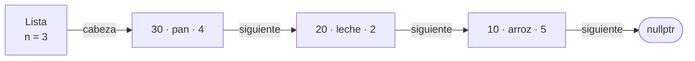
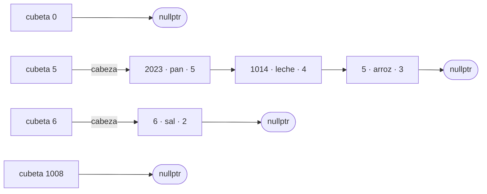
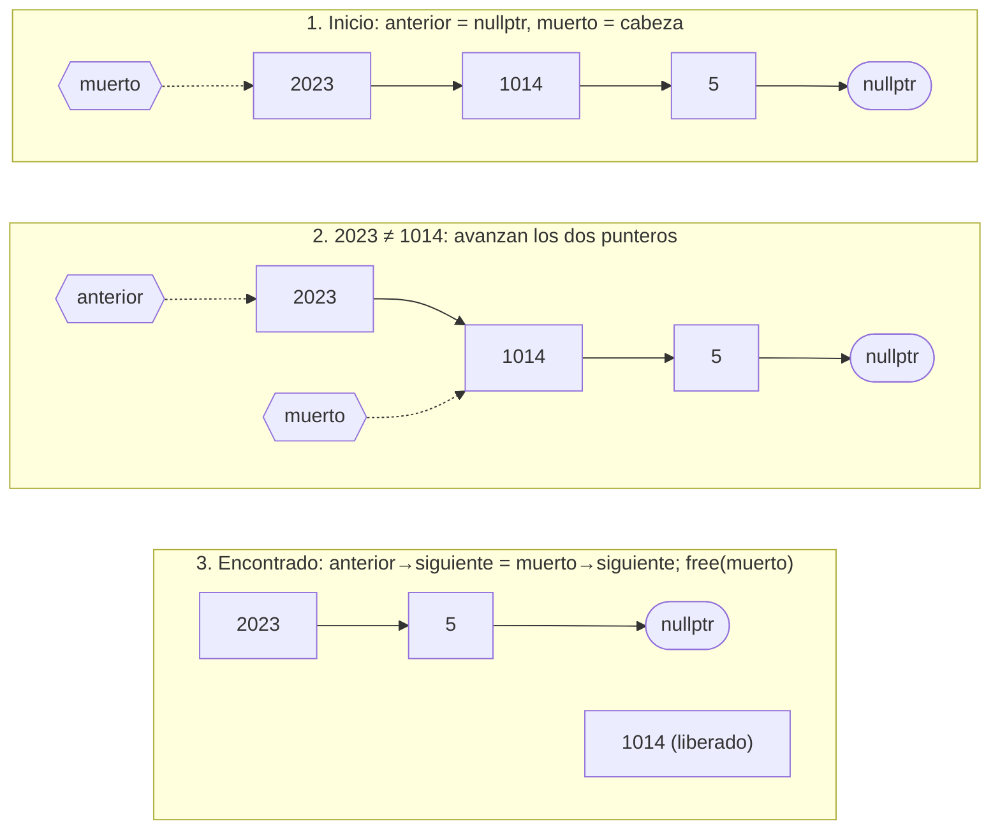
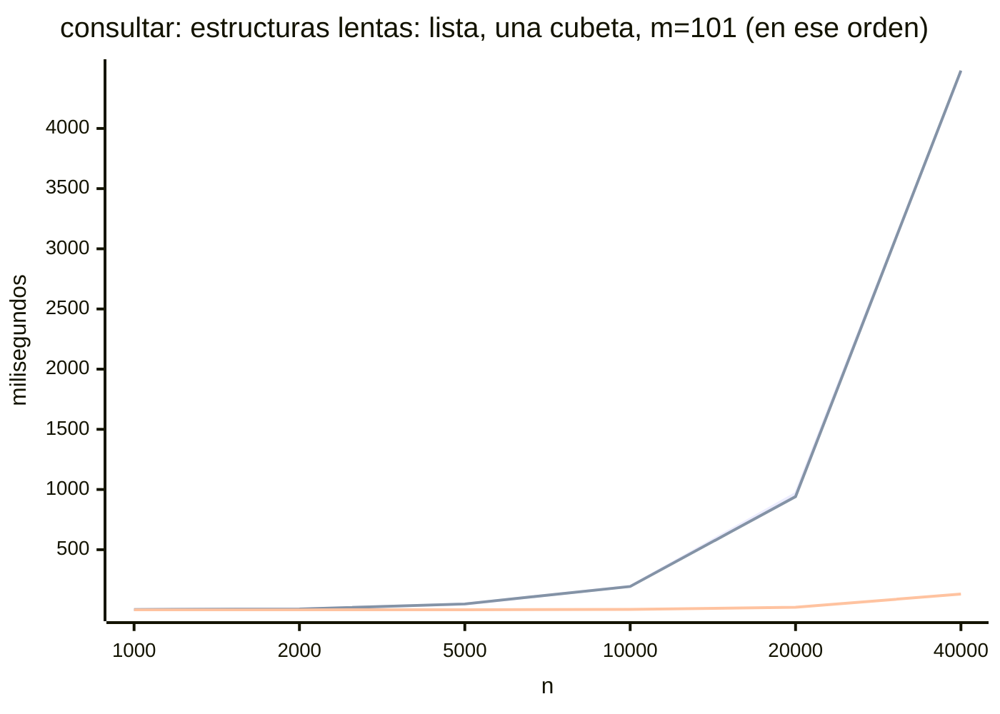
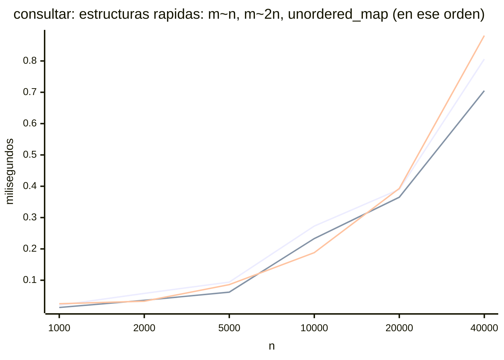
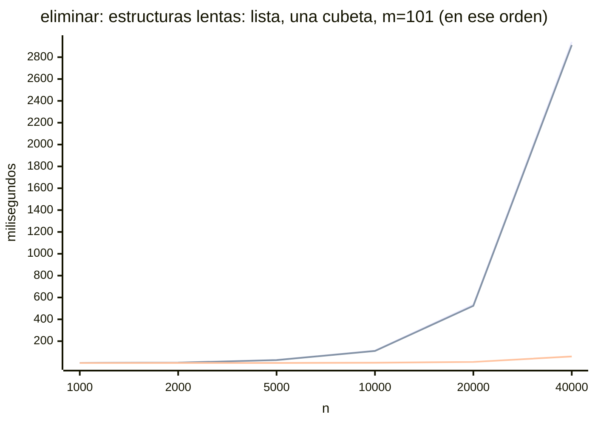
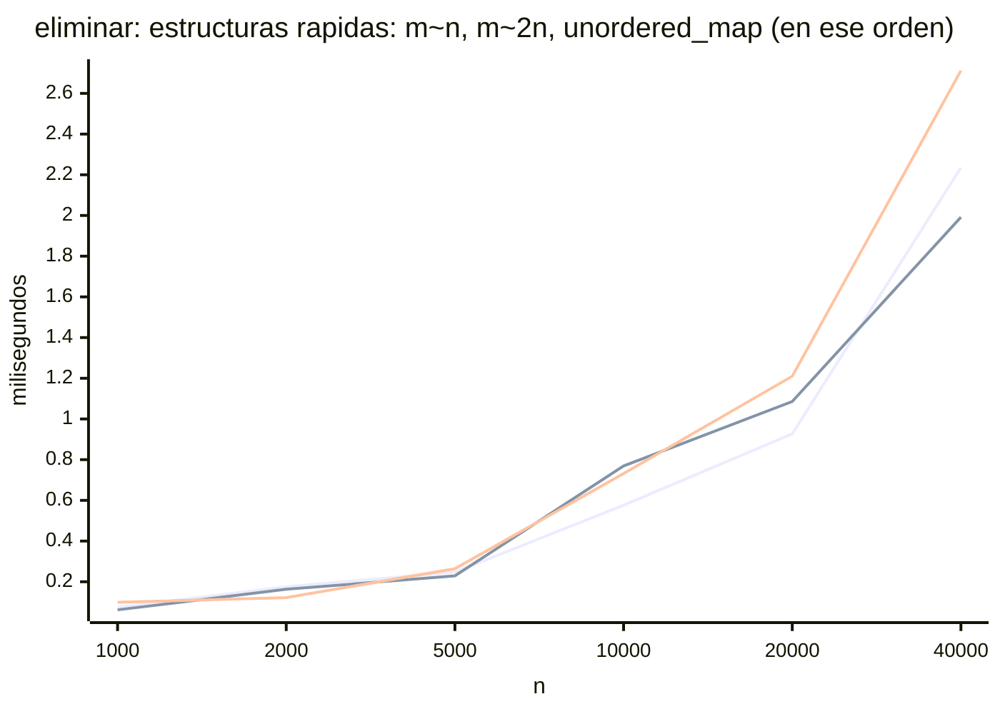

# Informe final

## 1. El escenario y el modelado

Nuestro escenario corresponde al inventario de una tienda, el cual puede ser usado por el encargado para poder llevar un control de manera correcta sobre sus productos.
La información que este maneja y guarda es: un código único que identifica a cada producto para que no se confunda con algún otro, el nombre del artículo y por último la cantidad que haya de ese producto. 

Este inventario resuelve muchas situaciones que serían complicadas de afrontar si en la tienda no se tiene una herramienta que permita llevar el control de los artículos disponibles en esta. Por ejemplo, cuando llega mercancía nueva, se agota un producto o un cliente pregunta si hay existencias de alguno, entre muchas otras.

El programa se comunica de manera que el usuario le otorga unas órdenes, en donde debe colocar unos parámetros específicos y este responde con algunos textos de acuerdo a lo que se le haya pedido. Los detalles están en el siguiente numeral. 

Casi todas las operaciones del inventario (como consultar, reponer, eliminar e incluso agregar, que debe detectar códigos repetidos) comienzan por encontrar el artículo a partir de su código. Cuando el inventario tiene pocos artículos no hay ningún problema, sin embargo, al escalarlo con miles de artículos el costo de buscar predomina sobre todo lo demás. Por esta razón, el proyecto resuelve el mismo problema con dos estructuras: en primer lugar, una lista enlazada simple, donde buscar recorre los nodos, y en segundo lugar, una tabla hash con encadenamiento, que reparte los artículos en cubetas para buscar solo en una de ellas. Además se mide `std::unordered_map` como referencia de una implementación de la biblioteca estándar.

Las dos estructuras reciben las mismas órdenes y por eso deben responder lo mismo con igual entrada, de manera que sea posible medirlas con un solo programa y así comparar sus salidas. La única diferencia esperada es el orden en que sale `listar`, que depende de la estructura y se explica en la sección 2, en el apartado sobre el orden de `LISTAR`.

## 2. Las dos estructuras

Cada artículo del inventario guarda tres datos: su código (debe ser entero positivo único), su nombre (una palabra sin espacios, de a lo sumo 63 caracteres) y su cantidad (también entera positiva).

Las dos estructuras guardan esos mismos artículos, pero organizados
de forma distinta:

- **Lista enlazada simple:** cada nodo guarda un artículo y un
  puntero al siguiente nodo; la estructura guarda un puntero al primero
  (`cabeza`) y el número de artículos $n$.
- **Tabla hash con encadenamiento:** un arreglo de $m$
  cubetas, donde cada cubeta es una lista enlazada como la del avance, y el número total de artículos n de toda la tabla. La función que decide en qué cubeta va cada código se describe en la sección 3.

Así se ve la lista con tres artículos. Cada nodo guarda código, nombre y
cantidad; `agregar` inserta por la cabeza, así que el último agregado queda
primero:



Y así se ve la tabla con $m = 1009$ cubetas después de agregar, en orden, los
códigos 5, 1014, 2023 y 6 (el caso de prueba 07). Como
$5 \bmod 1009 = 1014 \bmod 1009 = 2023 \bmod 1009 = 5$, los tres primeros
**chocan** en la cubeta 5 y quedan encadenados en la lista de esa cubeta, el
último agregado primero. El 6 cae solo en la cubeta 6, y las demás cubetas
están vacías:



Las operaciones son las mismas en las dos estructuras:

| Operación | Qué hace | Precondición |
|---|---|---|
| Agregar (id, nombre, cantidad) | Añade un producto al inventario, con su id, nombre y cantidad. Responde `ok` si se añadió, o `repetido` si el artículo ya estaba o `invalido` si se coloca una cantidad o codigo no positivos. | $\text{id} > 0$; nombre no vacío, sin espacios, de a lo sumo 63 caracteres (cabe en `char nombre[64]`); $\text{cantidad} > 0$ |
| Eliminar (id) | Quita el artículo con ese id del inventario. Responde `ok` si se eliminó, o `no existe` si no estaba. | Inventario no vacío ($n \geq 1$) e $\text{id} > 0$, ya que con el inventario vacío no hay nada que quitar. |
| Consultar (id) | Muestra el artículo con ese id: responde con su id, nombre y cantidad, o con `no existe` si no está. No modifica nada. |  Inventario no vacío ($n \geq 1$) e $\text{id} > 0$. |
| Reponer (id, cantidad) | Aumenta la cantidad de un artículo que ya está en el inventario. Responde `ok` si se repuso, o `no existe` si el artículo no está o `invalido` si se coloca una cantidad o codigo no positivos. | Inventario no vacío ($n \geq 1$), $\text{id} > 0$ y $\text{cantidad} > 0$, puesto que con cantidad negativa reponer restaría existencias. |
| Listar | Muestra todos los artículos del inventario, uno por línea. No modifica nada. | Ninguna. Con el inventario vacío no muestra nada. |

Las dos estructuras, y también el envoltorio de `std::unordered_map` que se usa como referencia, ofrecen las mismas operaciones con las mismas firmas, es decir la misma interfaz. 
Esto sucede debido a que el programa que mide los tiempos debe poder usar una u otra sin cambiar y si las interfaces fueran distintas, el programa de medición tendría que tratar cada estructura de forma diferente, y una diferencia en los tiempos podría deberse a ese código como tal y no a la estructura. Entonces, por esta razón, con una sola interfaz lo único que cambia entre una medición y otra es la estructura, y por eso las diferencias medidas pueden ser atribuidas a ella. 

Por otra parte, también ayuda al diseño puesto que, como cada cubeta de la tabla es una lista del avance, la tabla elige la cubeta con la función hash y delega en ella la operación.

Es justamente por lo anterior que las precondiciones realizadas en primer lugar valen para las dos estructuras. En la tabla, "inventario no vacío" significa $n \geq 1$ para toda la tabla, no para una cubeta: una cubeta puede estar vacía aunque la tabla no lo esté.

La construcción de la tabla requiere indicar el número de cubetas.

**Casos especiales:**

- Con el inventario vacío, `CONSULTAR`, `ELIMINAR` y `REPONER` con datos válidos responden `no existe`. Con un código no positivo, `CONSULTAR` y `ELIMINAR` también responden `no existe`. En estos casos el inventario no cambia.

- Para el nombre en agregar, si se pasa de 63 caracteres el programa trunca el sobrante, es decir, descarta todos los caracteres que no estén dentro de ese espacio de 63 y el resto de la palabra no afecta a las órdenes siguientes.

- Si `AGREGAR` o `REPONER` reciben un código o una cantidad que no son positivos, la orden responde `invalido` y no modifica la estructura. La respuesta es la misma en las dos estructuras y se menciona anteriormente en la tabla.

### Orden de `LISTAR`

La lista imprime en orden inverso al de inserción porque cada nodo nuevo
se coloca en la cabeza. La tabla recorre las cubetas por índice ascendente;
dentro de cada cubeta se conserva el orden inverso de inserción de su lista.
El contenedor de referencia, `std::unordered_map`, no garantiza un orden.

Si se necesita el mismo orden en todas las estructuras, una opción es
reunir los productos y ordenar por código antes de imprimir. Con un método
de ordenamiento por comparación de tiempo $O(n\log n)$, se añade ese costo
y un arreglo de $O(n)$ espacio a los recorridos originales. En la tabla
también se conserva el costo de recorrer las $m$ cubetas.

## 3. Análisis formal de complejidad

### Modelo de costo

Contamos operaciones elementales: cada comparación, asignación, operación
aritmética, evaluación de un `assert`, llamada a `free` y retorno cuesta una
unidad. Como en el avance, los nombres tienen longitud acotada (63
caracteres) y las operaciones sobre enteros cuestan una constante. $n$ es el
número de artículos guardados, $m$ el número de cubetas de la tabla,
$\alpha = n/m$ su factor de carga y $k_b$ el número de artículos de la cubeta
$b$.

Usamos la notación del avance: $v_i$ es el nodo en la posición $i$ y $c_i$ su
código, con $v_0 = \mathrm{cabeza}$. Por convención, $v_n = \mathrm{nullptr}$
y $v_{-1} = \mathrm{nullptr}$.

### Invariantes de la lista y de la tabla hash

Un invariante es una condición que debe cumplirse antes y después de cada operación.

**Lista enlazada.** Sea $r$ el número de nodos de una lista, y sean
$v_0,\ldots,v_{r-1}$ sus nodos en orden de recorrido. Si $r=0$, `cabeza`
vale `nullptr`. Si $r>0$, `cabeza` apunta a $v_0$ y el último nodo apunta
a `nullptr`. Cada nodo intermedio apunta al siguiente:

$$
\forall i\in\{0,\ldots,r-2\},\qquad
v_i.\mathrm{siguiente}=v_{i+1}.
$$

En el recorrido no se repiten nodos ni códigos:

$$
\forall i,j\in\{0,\ldots,r-1\},\qquad
i\ne j \Rightarrow
(v_i\ne v_j \land c_i\ne c_j).
$$

**Tabla hash.** Cada cubeta cumple los invariantes de una lista. Si $m$
es el número de cubetas y $k_b$ es la cantidad de productos en la cubeta $b$,
el contador total $n$ cumple:

$$
n=\sum_{b=0}^{m-1}k_b.
$$

Si $C_b$ es el conjunto de códigos guardados en la cubeta $b$, cada código
está ubicado en la cubeta que le corresponde por su residuo:

$$
\forall b\in\{0,\ldots,m-1\},\quad
\forall x\in C_b,\qquad x\bmod m=b.
$$

`consultar` conserva estas condiciones porque solo lee el inventario.
`reponer` también las conserva porque modifica únicamente la cantidad
del producto encontrado: no cambia su código, sus enlaces ni los contadores.

### Por qué usamos una tabla hash con encadenamiento

La lista enlazada fue apropiada para el avance: puede crecer nodo a nodo
y, una vez localizado el nodo que se quiere eliminar y su anterior,
se ajustan enlaces sin desplazar los elementos que siguen. Un arreglo
compacto sí puede requerir desplazamientos para conservar el orden. Una
pila o una cola tampoco ofrece como operación propia consultar por un
código arbitrario. La sección 10.2 de CLRS describe las listas enlazadas.

Varias operaciones del inventario empiezan por localizar un artículo por su
código. En la lista enlazada puede ser necesario recorrer todos los nodos.
La tabla hash calcula la cubeta con el residuo del código entre el número
de cubetas y busca únicamente en la lista de esa cubeta. El encadenamiento
permite guardar varios códigos distintos aunque tengan el mismo residuo.

Si los códigos se reparten uniformemente entre las cubetas, consultar y
reponer tienen un costo esperado $O(1+n/m)$, donde $n$ es el número de
artículos y $m$ el número de cubetas. Si todos los códigos caen en la misma
cubeta, la búsqueda puede recorrer los $n$ nodos. El espacio auxiliar de
ambas operaciones es $O(1)$ porque usan pocas variables de tamaño fijo,
sin copiar la lista ni reservar nodos.

En el peor caso la búsqueda cuesta $\Theta(n)$: basta buscar un código
ausente cuyo residuo corresponda a la cubeta que contiene los $n$ nodos.
La sección 11.2 de CLRS trata las colisiones y el encadenamiento, y la
sección 11.3, las funciones hash y el método de la división. Las cotas y
sus testigos se expresan con la notación de la sección 3.2.

### Consultar y reponer en la lista

**Teorema.** `consultar` y `reponer` tienen tiempo de peor caso $O(n)$ y espacio auxiliar $O(1)$.

**Estrategia.** Las dos operaciones llaman a `buscar`. Cuando se encuentra el producto, `consultar` copia sus datos a `salida` y `reponer` suma unidades a la cantidad existente. Como el registro tiene tamaño fijo, ambas acciones cuestan tiempo constante.

**Desarrollo.** Sea $x$ el código solicitado. Después de $j$ avances, el invariante de `buscar` es:

$$
0\le j\le n,\qquad
\mathrm{actual}=v_j,\qquad
\forall i\in\{0,\ldots,j-1\},\ c_i\ne x.
$$

Al inicio, $j=0$ y `actual` apunta a `cabeza`. Cada avance ocurre porque el nodo actual existe y su código no coincide. Por eso el invariante se conserva al pasar al nodo siguiente. Si el código no aparece, se llega a $v_n$, que es `nullptr`.

Cada avance cuesta como máximo tres unidades: dos comparaciones y una asignación. Fuera del ciclo, `buscar` usa hasta cuatro unidades: la asignación inicial, la evaluación final de la condición y el retorno. La operación que llama a `buscar` usa hasta diez unidades adicionales para las validaciones, las asignaciones, la decisión, la copia o la suma, y el retorno. Por tanto:

$$
T_L(n)\le 3j+14\le 3n+14\le 17n
\qquad \text{para } n\ge 1.
$$

**Conclusión.** Los testigos son $c=17$ y $k=1$. Si el código no existe, se recorren los $n$ nodos, de modo que el peor caso es $\Theta(n)$. Si está en el primer nodo, el tiempo es $O(1)$. El espacio auxiliar es $O(1)$ porque la cantidad de variables no crece con $n$.

### Consultar y reponer en la tabla hash

**Teorema.** Ambas operaciones cuestan $O(1+k_b)$, donde $k_b$ es la cantidad de productos en la cubeta del código. Su peor caso es $O(n)$ y su espacio auxiliar es $O(1)$.

**Estrategia.** La tabla calcula la cubeta con $b=x\bmod m$. Si está vacía, devuelve `false`. Si contiene productos, delega en `consultar` o `reponer` de esa lista.

**Desarrollo.** El cálculo del índice, el acceso a la cubeta, la comprobación de si está vacía y el manejo del resultado requieren una cantidad fija de operaciones, `indice` (2 assert, residuo, asignación, retorno: 5), tomar la referencia a la cubeta (1), asignar encontrado (1), vacia() (2), el `if` con la negación (1), asignar el resultado de la lista (1) y el retorno (1). Total $12\le 14$. Si la cubeta no está vacía, se aplica la cota de la lista con $k_b$ en vez de $n$. Si está vacía, se omite esa llamada. Como $k_b\le n$:

$$
T_H(n,m)\le 14+(3k_b+14)\le 3n+28\le 31n
\qquad \text{para } n\ge 1.
$$

**Conclusión.** Para el peor caso, los testigos son $c=31$ y $k=1$. Si todos los códigos caen en una sola cubeta, la búsqueda puede recorrer los $n$ productos. Bajo hashing uniforme (cada código cae en cada cubeta con probabilidad $1/m$, de forma independiente), si el código $x$ está en la tabla, la cubeta contiene a $x$ y a cada uno de los otros $n-1$ con probabilidad $1/m$. Si no está, contiene a cada uno de los $n$ con probabilidad $1/m$. En ambos casos

$$E[k_b]\le 1+\frac{n-1}{m}\le 1+\alpha.$$

Como $T_H\le 3k_b+28$ y la esperanza es lineal:

$$E[T_H]\le 3E[k_b]+28\le 3(1+\alpha)+28=31+3\alpha\le 31(1+\alpha).$$

Por tanto $E[T_H]\in O(1+\alpha)$ con testigos $c=31$ y $k=1$. 

De lo anterior, se puede decir que el tiempo esperado es $O(1+\alpha)$, con $\alpha=n/m$. Consultar no cambia el inventario y reponer solo cambia la cantidad del producto encontrado.

### Agregar en la lista y en la tabla hash

**Teorema.** `Lista::agregar` cuesta $O(n)$ en el peor caso. `TablaHash::agregar` cuesta $O(1+k_b)$ y su peor caso es $O(n)$. El espacio auxiliar es $O(1)$ en ambas.

**Estrategia.** La lista busca el código para impedir duplicados. Si el código no existe y se puede reservar memoria, copia el nombre y enlaza el nodo al principio. La tabla calcula la cubeta y delega la inserción en su lista.

**Desarrollo.** La búsqueda en la lista cuesta a lo sumo $3n+4$. El trabajo propio de `Lista::agregar` sin contar `buscar`, es:

- 3 assert (3)
- estado = 0 (1)
- comparación con buscar (1)
- malloc (1)
- asignación a nuevo (1)
- if (nuevo == nullptr) (1)
- código y cantidad (2)
- ciclo de copia: hasta 63 iteraciones de 4 unidades (2 comparaciones, 1 copia, 1 incremento), es decir 252
- condición final (2)
- terminador (1)
- nuevo->siguiente, cabeza (2)
- n++ (2)
- retorno (1)

Suma: $A=270$.

El trabajo propio de `TablaHash::agregar`, es: 

- 3 assert (3)
- indice (5)
- acceso a la cubeta (1)
- asignar estado (1)
- if (estado==0) (1)
- incremento (2)
- retorno (1). 

Suma: $H=14$.

De esta manera, las fórmulas quedan:

$$T_{L,\mathrm{agregar}}(n)\le 3n+4+270=3n+274\le 277n \quad (n\ge1),$$
$$T_{H,\mathrm{agregar}}(n,m)\le 14+3k_b+4+270\le 3n+288\le 291n \quad (n\ge1).$$

Testigos: $c=277,\ k=1$ para la lista y $c=291,\ k=1$ para la tabla.


**Conclusión.** Los testigos son $c=277$, $k=1$ para la lista y $c=291$, $k=1$ para la tabla. En la tabla, con hashing uniforme (cada código cae en cada cubeta con probabilidad $1/m$, de forma independiente), si el código $x$ está en la tabla, la cubeta contiene a $x$ y a cada uno de los otros $n-1$ con probabilidad $1/m$. Si no está, contiene a cada uno de los $n$ con probabilidad $1/m$. En ambos casos

$$E[k_b]\le 1+\frac{n-1}{m}\le 1+\alpha.$$

Como $T_{H,\mathrm{agregar}}\le 3k_b+288$ y la esperanza es lineal:

$$E[T_{H,\mathrm{agregar}}]\le 3E[k_b]+288\le 3(1+\alpha)+288=291+3\alpha\le 291(1+\alpha).$$

con testigos $c=291,\ k=1$.

Una inserción exitosa añade un nodo al inventario; si el código está repetido, no se añade ninguno. La búsqueda, la copia y el enlace usan una cantidad fija de punteros y contadores. El nuevo nodo permanece en el inventario y se cuenta como memoria almacenada, no como espacio temporal.

### Listar en la lista y en la tabla hash

**Teorema.** `Lista::listar` cuesta $\Theta(n)$ para $n\ge 1$, y `TablaHash::listar` cuesta $\Theta(m+n)$. Ambas usan espacio auxiliar $O(1)$.

**Estrategia.** La lista visita cada nodo e imprime su producto. La tabla recorre todas las cubetas, incluso las vacías, y llama a `listar` sobre cada una. Emitir una línea tiene costo acotado porque los nombres tienen longitud máxima y los campos numéricos son de tamaño fijo.

**Desarrollo.**   En la lista, sea $\ell(v)$ la línea codigo nombre cantidad del nodo $v$, y $S_j$ la secuencia de líneas impresas después de $j$ iteraciones. Cada vez que se evalúa la condición del while:

$$0\le j\le n \;\land\; \mathrm{actual}=v_j \;\land\; S_j=\langle \ell(v_0),\ldots,\ell(v_{j-1})\rangle .$$

Al inicio $j=0$, actual es cabeza $=v_0$ y $S_0$ es vacía, así que se cumple. Cada iteración imprime $\ell(v_j)$ y avanza a $v_{j+1}$, lo que conserva el invariante. Al salir, $\mathrm{actual}=v_n=\mathrm{nullptr}$ y $S_n$ contiene los $n$ nodos.

En la tabla, sea $i$ el índice del ciclo y $T_i$ el total de líneas impresas. Cada vez que se evalúa la condición:

$$0\le i\le m \;\land\; T_i=\sum_{b=0}^{i-1}k_b \;\land\; \forall b\in\{0,\ldots,i-1\},\ \text{la cubeta } b \text{ ya fue impresa completa}.$$

Al salir, $i=m$ y $T_m=\sum_{b=0}^{m-1}k_b=n$.

Haciéndolo con valores númericos, queda de esta manera: 

Sea $P$ el costo de imprimir una línea. Una línea tiene a lo sumo unos 100 caracteres (código de hasta 19 dígitos, nombre de 63, cantidad de hasta 11), así que $P\le 100$.

Lista: antes del ciclo, actual = cabeza (1) y la condición final (1), en total 2. Cada iteración cuesta condición (1) + impresión ($P$) + avance (1), es decir $P+2\le 102$.

$$T_{L,\mathrm{listar}}(n)\le 2+102n\le 104n \quad (n\ge 1).$$

Tabla: fijo: i = 0 y condición final (2). Por cubeta: condición (1), llamada (1), incremento (2) y el trabajo fijo de Lista::listar (2), en total 6. Más $102$ por cada artículo.

$$T_{H,\mathrm{listar}}(n,m)\le 2+6m+102n\le 104(m+n) \quad (m+n\ge1).$$

Testigos: $c=104$ y $k=1$ para las dos.

**Conclusión.** Los testigos son $c=104$ y $k=1$ para la lista y para la tabla, tomando $m+n$ como tamaño. Las cotas son ajustadas porque la lista visita todos sus nodos y la tabla, además, visita todas las cubetas. Una lista vacía termina en tiempo constante. Ninguna de las dos operaciones cambia el inventario. Se imprime cada producto al visitarlo, sin guardar una copia del listado: la lista usa un puntero y la tabla un índice de cubeta además de ese recorrido, por lo que el espacio auxiliar es $O(1)$.

### Eliminar en la lista

`Lista::eliminar` avanza con dos punteros, `anterior` y `muerto`, hasta
encontrar el código o llegar al final. Si lo encuentra, reenlaza y libera el
nodo.

**Invariante del ciclo.** Cada vez que se evalúa la condición del `while`,
después de $j$ iteraciones completas:

$$
0 \le j \le n \quad\land\quad \mathrm{muerto} = v_j \quad\land\quad \mathrm{anterior} = v_{j-1} \quad\land\quad \forall i \in \{0,\ldots,j-1\},\ c_i \neq \mathrm{codigo}.
$$

Al empezar, $j = 0$: `muerto` es `cabeza` $= v_0$, `anterior` es
`nullptr` $= v_{-1}$, y el cuantificador recorre un conjunto vacío, así que se
cumple. Una iteración solo ocurre si $c_j \neq \mathrm{codigo}$, y avanza los
dos punteros una posición, así que el invariante se conserva con $j + 1$. La
cantidad $n - j$ disminuye en cada iteración y nunca es negativa, por lo que
el ciclo termina.

Al salir, o bien $\mathrm{muerto} = \mathrm{nullptr}$, entonces $j = n$ y por
el invariante ningún nodo tenía el código; o bien `muerto` es el nodo $v_j$
con $c_j = \mathrm{codigo}$ y `anterior` es justo $v_{j-1}$, el nodo que hay
que reenlazar.

**Efecto sobre los invariantes de la lista.** Si el código estaba en la
posición $p$, la lista queda con $n' = n - 1$ nodos:

$$
v'_i = v_i \ \text{ para } 0 \le i < p, \qquad v'_i = v_{i+1} \ \text{ para } p \le i < n - 1.
$$

Los nodos que quedan conservan su orden y sus enlaces, ningún código se
repite porque solo se quitó uno, y si $p = 0$ la nueva `cabeza` es $v_1$ (o
`nullptr` si la lista queda vacía). Por eso se siguen cumpliendo los tres
invariantes del avance.

**Teorema.** El tiempo de `Lista::eliminar` cumple
$T^{L}_{\text{elim}}(n) \in O(n)$.

**Estrategia.** Se procede de forma directa: se cuentan las operaciones
antes del ciclo, en cada iteración y después del ciclo, y el número de
iteraciones se acota con el invariante.

*Desarrollo.* Antes del ciclo hay dos `assert` y dos asignaciones (`anterior`
y `muerto`): 4 unidades. Cada iteración evalúa las dos comparaciones de la
condición y hace dos asignaciones: 4 unidades. La evaluación final de la
condición cuesta a lo sumo 2. Después del ciclo, en el camino más largo
(código encontrado): calcular y asignar `encontrado` (2), el `if` (1), la
comparación de `anterior` con `nullptr` (1), el reenlace (1), `free` (1), la
resta y asignación de `n` (2) y el retorno (1): a lo sumo 9. Por el
invariante, $j \le n$:

$$
T^{L}_{\text{elim}}(n) \le 4 + 4j + 2 + 9 \le 4n + 15 \le 4n + 15n = 19n \quad \text{para todo } n \geq 1.
$$

El último paso usa que $15 \le 15n$ cuando $n \ge 1$.

*Conclusión.* Por lo tanto, $T^{L}_{\text{elim}}(n) \in O(n)$ con testigos
$c = 19$ y $k = 1$. La cota es ajustada: si el código no está, el ciclo hace
las $n$ iteraciones y $T^{L}_{\text{elim}}(n) \ge 4n$, así que el peor caso
es $\Theta(n)$. El mejor caso, el código en `cabeza`, es $O(1)$. El espacio
auxiliar es $O(1)$: dos punteros y un booleano.

### Eliminar en la tabla hash

`TablaHash::eliminar` calcula $b = h(\mathrm{codigo}) = \mathrm{codigo} \bmod m$,
revisa que la cubeta $b$ no esté vacía y delega en `Lista::eliminar` sobre esa
cubeta, que tiene $k_b$ artículos.

**Efecto sobre los invariantes de la tabla.** Sea $E \in \{0, 1\}$ igual a 1
si se eliminó el artículo. Al terminar:

$$
\mathrm{numeroArticulos}' = \mathrm{numeroArticulos} - E \quad\land\quad \mathrm{numeroArticulos}' = \sum_{i=0}^{m-1} k'_i \quad\land\quad \forall i \neq b,\ k'_i = k_i.
$$

Solo cambia la cubeta $b$, que pierde exactamente $E$ nodos, y el contador
baja solo cuando `cubeta.eliminar` devuelve `true`. Las demás cubetas no se
tocan, así que sigue cumpliéndose que todo nodo de la cubeta $i$ tiene código
$c$ con $h(c) = i$.

**Teorema (peor caso).** El tiempo de `TablaHash::eliminar` cumple
$T^{H}_{\text{elim}}(n) \in O(n)$.

**Estrategia.** Se procede de forma directa: se cuenta el trabajo propio de
la tabla, que es constante, y se le suma el costo de `Lista::eliminar` sobre
una sola cubeta, que es el teorema anterior con $n$ cambiado por $k_b$.

*Desarrollo.* Las operaciones propias de la tabla son: dos `assert` (2), la
asignación de `eliminado` (1), `indice` (dos `assert`, el residuo, la
asignación y el retorno: 5), tomar la referencia a la cubeta (1), `vacia()`
de la cubeta (comparación y retorno: 2), la negación y el `if` (1), asignar
el resultado (1), el `if (eliminado)` (1), el decremento (2) y el retorno (1):
en total a lo sumo 17. Por el teorema anterior, `Lista::eliminar` sobre la
cubeta cuesta a lo sumo $4k_b + 15$, y una cubeta no puede tener más
artículos que toda la tabla, $k_b \le n$:

$$
T^{H}_{\text{elim}}(n) \le 17 + 4k_b + 15 \le 4n + 32 \le 4n + 32n = 36n \quad \text{para todo } n \geq 1.
$$

*Conclusión.* Por lo tanto, $T^{H}_{\text{elim}}(n) \in O(n)$ con testigos
$c = 36$ y $k = 1$. La cota se alcanza cuando todos los códigos caen en la
misma cubeta ($k_b = n$): la tabla se comporta como la lista. Es el
experimento «una cubeta» de la sección 4.

**Teorema (caso esperado).** Bajo la hipótesis de hashing uniforme (cada
código cae en cualquiera de las $m$ cubetas con probabilidad $1/m$, de forma
independiente de los demás), el tiempo esperado de `TablaHash::eliminar`
cumple $E\!\left[T^{H}_{\text{elim}}\right] \in O(1 + \alpha)$. Si además
$m \ge n$, entonces $E\!\left[T^{H}_{\text{elim}}\right] \in O(1)$.

**Estrategia.** Se procede de forma directa: se acota el tamaño esperado de
la cubeta $b$ y se usa que la cota del costo es lineal en $k_b$.

*Desarrollo.* Si el código está en la tabla, la cubeta $b$ contiene ese
artículo y cada uno de los otros $n - 1$ con probabilidad $1/m$. Si no está,
contiene cada uno de los $n$ con probabilidad $1/m$. En los dos casos:

$$
E[k_b] \le 1 + \frac{n - 1}{m} \le 1 + \frac{n}{m} = 1 + \alpha.
$$

Como $T^{H}_{\text{elim}} \le 4k_b + 32$ y la esperanza es lineal:

$$
E\!\left[T^{H}_{\text{elim}}\right] \le 4\,E[k_b] + 32 \le 4(1 + \alpha) + 32 = 36 + 4\alpha \le 36(1 + \alpha).
$$

Si $m \ge n$, entonces $\alpha \le 1$ y

$$
E\!\left[T^{H}_{\text{elim}}\right] \le 36 + 4 = 40 \le 40 \cdot 1 \quad \text{para todo } n \geq 1.
$$

*Conclusión.* Por lo tanto, $E\!\left[T^{H}_{\text{elim}}\right] \in O(1 + \alpha)$
con testigos $c = 36$ y $k = 1$, y con $m \ge n$ (las configuraciones
$m \approx n$ y $m \approx 2n$ de los experimentos) es $O(1)$ con $c = 40$ y
$k = 1$. El espacio auxiliar es $O(1)$: la referencia a la cubeta, un booleano
y los dos punteros de `Lista::eliminar`. Este resultado coincide con el
análisis del encadenamiento en Cormen, Leiserson, Rivest y Stein,
*Introduction to Algorithms*, 4.ª edición, MIT Press, 2022, capítulo 11,
sección 11.2.

**Traza.** Así avanza `eliminar(1014)` sobre la tabla del diagrama de la
sección 2: `indice` da $1014 \bmod 1009 = 5$, la cubeta 5 no está vacía y la
tabla delega en `Lista::eliminar` de esa cubeta. El código está en medio de
la cadena, así que hace una iteración y luego reenlaza:



Al final la cubeta 5 queda con 2023 y 5, `numeroArticulos` baja de 4 a 3 y
las demás cubetas no se tocan.

### Construcción y destrucción

**Teorema.** Construir una lista vacía cuesta $\Theta(1)$; destruir una
lista de $n$ nodos, $\Theta(n+1)$. Construir la tabla cuesta $\Theta(m)$
para $m\ge 1$; destruirla cuesta $\Theta(m+n)$.

**Estrategia.** Se cuentan las inicializaciones y liberaciones. En el
modelo de costo, inicializar una lista vacía o liberar un nodo tiene
costo acotado por una constante.

**Desarrollo.** El constructor de la lista inicializa `cabeza` y el
contador. Su destructor recorre sus $n$ nodos y libera cada uno una vez.
El constructor de la tabla crea $m$ listas vacías; su destructor llama al
destructor de cada una. Si $A$ acota el trabajo fijo de la operación y
$B$ el trabajo de cada unidad visitada, con $A,B>0$, se obtiene:

$$
T\le A+Bq\le (A+B)q \qquad (q\ge 1),
$$

donde $q=1$ para crear la lista, $q=n+1$ para destruirla, $q=m$ para
crear la tabla y $q=m+n$ para destruirla. En el último caso se recorren
$m$ listas y se liberan $\sum_{b=0}^{m-1}k_b=n$ nodos.

Reemplazando A y B por valores numéricos:

| Operación | Fijo ($A$) | Por unidad ($B$) | Testigo $c = A + B$ |
| :--- | :--- | :--- | :--- |
| Constructor de `Lista` | 2 (dos asignaciones) | 0 | 2 |
| Destructor de `Lista` | 2 (asignación inicial y condición final) | 4 por nodo (`siguiente`, `free`, `actual`, condición) | 6 |
| Constructor de `TablaHash` | 5 (`assert`, 2 asignaciones, `new`, asignación de `cubetas`) | 3 por cubeta (llamada al constructor de `Lista`, 2 asignaciones) | 8 |
| Destructor de `TablaHash` | 1 (`delete[]`) | 4 por cubeta (llamada + trabajo fijo del destructor de `Lista`), y 4 por nodo | 5 |

Con $A,B$ numéricos, los testigos pasan a ser $c=A+B$, por ejemplo $c=6$ para destruir la lista, exactamente, los testigos son $c=2$, $6$, $8$ y $5$ según la operación.

**Conclusión.** Para cada cota superior sirven los testigos $c=A+B$ y
$k=1$, con las constantes correspondientes a la operación. Las cotas
son ajustadas porque las inicializaciones y liberaciones descritas se
realizan efectivamente. Los recorridos usan espacio auxiliar constante;
el arreglo de $m$ cubetas es memoria propia de la tabla.

### Análisis de espacio

Sean $s_N$, $s_L$ y $s_H$ los tamaños en bytes de `Nodo`, `Lista` y
`TablaHash`, que el compilador fija y no dependen de $n$. En la máquina de los
experimentos (Windows con g++ de MinGW-w64), `long` ocupa 4 bytes, y con
`sizeof` se obtiene: $s_N = 80$ (el `Producto` ocupa 72: 4 del código, 64 del
nombre y 4 de la cantidad; más 8 del puntero `siguiente`), $s_L = 16$ y
$s_H = 16$. En Linux, donde `long` ocupa 8 bytes, $s_N = 88$; las cotas
asintóticas son las mismas y solo cambian las constantes. Contamos los bytes
que reserva cada estructura; el encabezado que `malloc` agrega a cada bloque
es otra constante por nodo y no cambia las cotas.

Que `long` sea de 4 bytes también limita los códigos a
$2^{31} - 1 = 2\,147\,483\,647$. Alcanza para nuestras pruebas y mediciones
(los códigos aleatorios llegan a $10^9$ y los de colisión, a
$40000 \cdot 40009 \approx 1{,}6 \cdot 10^9$), pero no para un código de barras
real de 12 o 13 dígitos; para eso habría que usar `long long`.

**Teorema.** El espacio de la lista con $n \ge 1$ artículos cumple
$S^{L}(n) \in O(n)$.

**Estrategia.** Se procede de forma directa: la lista guarda el objeto
`Lista` y exactamente un nodo por artículo.

*Desarrollo.*

$$
S^{L}(n) = s_L + s_N\, n = 16 + 80n \le 16n + 80n = 96n \quad \text{para todo } n \geq 1.
$$

*Conclusión.* Por lo tanto, $S^{L}(n) \in O(n)$ con testigos $c = 96$ y
$k = 1$. Como además $S^{L}(n) \ge 80n$, el espacio es $\Theta(n)$.

**Teorema.** El espacio de la tabla con $n$ artículos y $m$ cubetas cumple
$S^{H}(n, m) \in O(n + m)$; si $m \le 4n$, $S^{H}(n) \in O(n)$.

**Estrategia.** Se procede de forma directa: la tabla guarda el objeto
`TablaHash`, el arreglo de $m$ objetos `Lista` (uno por cubeta, aunque esté
vacía) y un nodo por artículo.

*Desarrollo.*

$$
S^{H}(n, m) = s_H + s_L\, m + s_N\, n = 16 + 16m + 80n \le 96(n + m) \quad \text{para todo } n + m \geq 1.
$$

En los experimentos $m$ es 101, el primo $\ge n$ o el primo $\ge 2n$. Por el
postulado de Bertrand siempre hay un primo entre $2n$ y $4n$, así que en los
tres casos $m \le 4n$ (para $n \ge 26$ en el caso $m = 101$), y entonces

$$
S^{H}(n) \le 16 + 16 \cdot 4n + 80n = 144n + 16 \le 160n \quad \text{para todo } n \geq 1.
$$

*Conclusión.* Por lo tanto, $S^{H}(n, m) \in O(n + m)$ con testigos $c = 96$
y $k = 1$, y con $m \le 4n$ es $O(n)$ con $c = 160$ y $k = 1$. Frente a la
lista, la tabla gasta $16m$ bytes más: es el precio de tener cubetas vacías.

Para `unordered_map`, la biblioteca estándar de g++ (libstdc++) usa una
tabla hash con encadenamiento, como la nuestra: cada artículo ocupa un nodo
con un puntero al siguiente y el par clave-producto, y además guarda un
arreglo de cubetas. A diferencia de nuestra tabla, la redimensiona sola para
que haya al menos tantas cubetas como artículos, así que su espacio es
$\Theta(n)$ sin tener que escoger $m$.

Resumen de costos:

| Operación | Estructura | Peor caso (testigos) | Caso esperado | Espacio auxiliar |
| :--- | :--- | :--- | :--- | :--- |
| Consultar y reponer | Lista | $O(n), c = 17, k = 1$ | no aplica | $O(1)$ |
| Consultar y reponer | Tabla | $O(n), c = 31, k = 1$ | $O(1 + \alpha), c = 31, k = 1$ | $O(1)$ |
| Agregar | Lista | $O(n), c = 277, k = 1$ | no aplica | $O(1)$ |
| Agregar | Tabla | $O(n), c = 291, k = 1$ | $O(1 + \alpha), c = 291, k = 1$ | $O(1)$ |
| Eliminar | Lista | $O(n), c = 19, k = 1$ | no aplica | $O(1)$ |
| Eliminar | Tabla | $O(n), c = 36, k = 1$ | $O(1 + \alpha), c = 36; O(1)$ si $m \ge n, c = 40$ | $O(1)$ |
| Listar | Lista | $\Theta(n), c = 104, k = 1$ | igual | $O(1)$ |
| Listar | Tabla | $\Theta(m + n), c = 104, k = 1$ | igual | $O(1)$ |
| Construir | Lista / Tabla | $\Theta(1), c = 2$ / $\Theta(m), c = 8$ | igual | $O(1)$ / $O(m)$ |
| Destruir | Lista / Tabla | $\Theta(n + 1), c = 6$ / $\Theta(m + n), c = 5$ | igual | $O(1)$ |
| Espacio total | Lista | $\Theta(n), c = 96$ | igual | |
| Espacio total | Tabla | $\Theta(n + m), c = 96; O(n)$ si $m \le 4n, c = 160$ | igual | |

Comparando con la biblioteca: 

| Operación | Tabla propia | `unordered_map` | Por qué |
| :--- | :--- | :--- | :--- |
| Consultar, reponer, eliminar | $O(1 + \alpha)$ esperado; $O(n)$ peor | $O(1)$ promedio; $O(n)$ peor | Ambas buscan solo en la cubeta del código. |
| Agregar | $O(1 + \alpha)$ esperado; $O(n)$ peor | $O(1)$ amortizado; $O(n)$ peor | La biblioteca redimensiona; la nuestra no. |
| Listar | $\Theta(m + n)$ | $\Theta(n)$ | La nuestra recorre también las cubetas vacías. |
| Espacio | $\Theta(n + m)$ | $\Theta(n)$ | La biblioteca ajusta las cubetas a $n$. |

## 4. Experimentos

### 4.1 Pruebas de corrección

Antes de medir, verificamos que las tres estructuras respondan lo mismo con la
misma entrada. `make pruebas` corre cada caso de `datos/` con el programa de la
lista, el de la tabla (1009 cubetas) y el de `unordered_map`. Como `LISTAR`
sale en orden distinto en cada estructura (en la lista, del último al primero
agregado; en la tabla, por cubeta; en `unordered_map`, en el orden interno de
sus nodos), un caso con `LISTAR` puede tener además un archivo
`nombre.tabla.out` o `nombre.mapa.out` con la salida esperada de esa
estructura.

Además de los casos del avance, agregamos tres casos pensados para la tabla:

| Caso | Tipo | Qué verifica |
|---|---|---|
| 07 | funcional | Eliminar con colisiones: 5, 1014 y 2023 caen en la cubeta 5; elimina en medio de la cadena, repite una eliminación y elimina un código cuya cubeta está vacía aunque la tabla no lo esté. |
| 08 | límite | Bordes del índice: 1009 (cubeta 0), 1008 (cubeta $m-1$) y 2018 (cubeta 0 otra vez); vacía la tabla, consulta y elimina sobre ella vacía y vuelve a agregar. |
| 09 | límite | Eliminar con códigos no positivos (`0` y `-5`) con el inventario lleno: responde `no existe` sin modificar nada. En la tabla esto evita un índice negativo, porque el residuo de un número negativo es negativo. Luego elimina los dos productos y repite una eliminación. |

Salida de `make pruebas`:

```
  OK    lista  01_ejemplo_enunciado.in
  OK    lista  02_agregar_listar.in
  OK    lista  03_consultar_reponer.in
  OK    lista  04_eliminar.in
  OK    lista  05_limite_vacio.in
  OK    lista  06_limite_borde.in
  OK    lista  07_eliminar_colisiones.in
  OK    lista  08_limite_tabla.in
  OK    lista  09_limite_eliminar.in
  OK    tabla  01_ejemplo_enunciado.in
  OK    tabla  02_agregar_listar.in
  OK    tabla  03_consultar_reponer.in
  OK    tabla  04_eliminar.in
  OK    tabla  05_limite_vacio.in
  OK    tabla  06_limite_borde.in
  OK    tabla  07_eliminar_colisiones.in
  OK    tabla  08_limite_tabla.in
  OK    tabla  09_limite_eliminar.in
  OK    mapa  01_ejemplo_enunciado.in
  OK    mapa  02_agregar_listar.in
  OK    mapa  03_consultar_reponer.in
  OK    mapa  04_eliminar.in
  OK    mapa  05_limite_vacio.in
  OK    mapa  06_limite_borde.in
  OK    mapa  07_eliminar_colisiones.in
  OK    mapa  08_limite_tabla.in
  OK    mapa  09_limite_eliminar.in
```

### 4.2 Cómo se midió

**Máquina.** Todas las mediciones se hicieron en el mismo computador: un
portátil con procesador Intel Core i7-13620H de 13.ª generación (2,40 GHz,
caché L2 de 1,25 MB por núcleo de rendimiento y caché L3 de 24 MB
compartida), 32 GB de RAM y Windows de 64 bits. Se compiló con
g++ 14.2.0 (MinGW-W64, UCRT) y las banderas `g++ -Wall -Wextra -O2`, y se
corrió `make medir` desde Git Bash con el portátil conectado a la corriente y
los demás programas cerrados.

**Qué se mide.** El programa `codigo/medir.cpp` toma $n$ códigos distintos y,
sobre una estructura vacía, mide por separado tres fases: agregar los $n$
artículos, consultarlos todos y eliminarlos todos. Las consultas y las
eliminaciones van en un orden aleatorio distinto al de inserción. Igual que
`principal.cpp`, la medición es una plantilla que solo usa la interfaz común,
y `main` construye la estructura. La columna `encontrados` cuenta las
consultas que respondieron que el artículo estaba y debe ser $n$: así
verificamos que cada estructura funciona mientras se mide.

**Entradas.** Los códigos se generan con semilla fija (2026), así que las tres
estructuras reciben exactamente la misma entrada:

- *Aleatorio:* $n$ códigos distintos al azar entre $1$ y $10^9$.
- *Una cubeta:* los códigos $m, 2m, \dots, nm$, que tienen residuo 0 y caen
  todos en la cubeta 0. Es el peor caso de la tabla.

**Configuraciones.** Para cada $n \in \{1000, 2000, 5000, 10000, 20000, 40000\}$
medimos: la lista; la tabla con $m = 101$ (tabla pequeña, $\alpha$ crece con
$n$), con $m$ el primo $\ge n$ ($\alpha \approx 1$) y con $m$ el primo
$\ge 2n$ ($\alpha \approx 1/2$); la tabla con todos los códigos en una cubeta;
y `unordered_map` como referencia.

**Repeticiones.** Cada configuración se mide 5 veces y se reporta la mediana,
que es menos sensible que el promedio a una repetición interrumpida por el
sistema operativo. Cada repetición corre en un proceso nuevo: si se repite
dentro del mismo programa, los nodos liberados al eliminar en desorden quedan
revueltos en la memoria dinámica, y desde la segunda repetición la lista
recibe nodos dispersos y se ve más lenta por cómo quedó la memoria, no por la
estructura.

### 4.3 Resultados

Mediciones en `datos/mediciones.csv` (mediana de 5 repeticiones; las 5
repeticiones de cada configuración están en `datos/mediciones-crudas.csv`). En
todas las filas `encontrados` $= n$, así que las tres operaciones respondieron
bien en todas las estructuras mientras se medía.

**agregar (ms, mediana de las repeticiones)**

| $n$ | lista | tabla $m=101$ | tabla $m \approx n$ | tabla $m \approx 2n$ | tabla, una cubeta | `unordered_map` |
|---|---|---|---|---|---|---|
| 1000 | 3.194 | 0.175 | 0.122 | 0.105 | 2.844 | 0.245 |
| 2000 | 9.104 | 0.422 | 0.288 | 0.267 | 8.993 | 0.306 |
| 5000 | 50.642 | 1.088 | 0.503 | 0.451 | 49.574 | 0.578 |
| 10000 | 198.676 | 4.563 | 1.156 | 1.352 | 195.473 | 1.157 |
| 20000 | 989.222 | 19.853 | 1.696 | 2.031 | 991.530 | 2.404 |
| 40000 | 4619.468 | 117.091 | 3.523 | 3.696 | 4521.548 | 4.861 |

**consultar (ms, mediana de las repeticiones)**

| $n$ | lista | tabla $m=101$ | tabla $m \approx n$ | tabla $m \approx 2n$ | tabla, una cubeta | `unordered_map` |
|---|---|---|---|---|---|---|
| 1000 | 2.514 | 0.066 | 0.020 | 0.013 | 2.366 | 0.025 |
| 2000 | 7.444 | 0.150 | 0.058 | 0.036 | 7.257 | 0.033 |
| 5000 | 47.889 | 0.785 | 0.094 | 0.062 | 49.059 | 0.086 |
| 10000 | 195.788 | 3.441 | 0.273 | 0.233 | 193.963 | 0.188 |
| 20000 | 965.879 | 20.972 | 0.390 | 0.365 | 941.165 | 0.393 |
| 40000 | 4473.236 | 131.060 | 0.806 | 0.705 | 4480.810 | 0.881 |

**eliminar (ms, mediana de las repeticiones)**

| $n$ | lista | tabla $m=101$ | tabla $m \approx n$ | tabla $m \approx 2n$ | tabla, una cubeta | `unordered_map` |
|---|---|---|---|---|---|---|
| 1000 | 0.989 | 0.111 | 0.074 | 0.062 | 0.998 | 0.099 |
| 2000 | 3.837 | 0.192 | 0.176 | 0.163 | 3.678 | 0.122 |
| 5000 | 27.695 | 0.682 | 0.247 | 0.229 | 26.511 | 0.264 |
| 10000 | 113.909 | 2.197 | 0.576 | 0.769 | 110.140 | 0.732 |
| 20000 | 534.838 | 9.809 | 0.927 | 1.086 | 523.662 | 1.210 |
| 40000 | 2938.821 | 59.834 | 2.235 | 1.992 | 2911.146 | 2.712 |









Las gráficas `xychart-beta` no dibujan leyenda, por eso el título de cada una
dice el orden de sus líneas. Van separadas en estructuras lentas y rápidas
porque, en una sola gráfica, las curvas de la tabla con $m \ge n$ y de
`unordered_map` quedarían pegadas al eje: a $n = 40000$ la lista tarda más de
4 segundos en consultar, y la tabla y `unordered_map`, menos de 1 milisegundo.

## 5. Lo medido contra lo predicho

Cada fase hace $n$ operaciones, así que lo medido es el costo **total** de $n$
operaciones. Por la sección 3, eso da:

| Estructura | Costo de una operación | Total de $n$ operaciones |
|---|---|---|
| Lista | $\Theta(n)$ | $\Theta(n^2)$ |
| Tabla, $m \ge n$ | $O(1 + \alpha)$ con $\alpha \le 1$, es decir $O(1)$ | $\Theta(n)$ |
| Tabla, $m = 101$ | $O(1 + n/101)$ | $\Theta(n + n^2/101)$: lineal con $n$ pequeño, cuadrático con $n$ grande |
| Tabla, una cubeta | $\Theta(n)$, peor caso | $\Theta(n^2)$ |
| `unordered_map` | $O(1)$ promedio (amortizado al agregar) | $\Theta(n)$ |

Una forma directa de comparar es ver cuánto se multiplica el tiempo cuando
$n$ crece. Si el total es $\Theta(n^2)$, al pasar de $n$ a $2n$ el tiempo se
multiplica por $4$, y al pasar de $2000$ a $5000$ (factor $2{,}5$) por
$2{,}5^2 = 6{,}25$. Si es $\Theta(n)$, se multiplica por $2$ y por $2{,}5$.
Con los tiempos de `consultar`:

| Paso de $n$ | Predicho $n^2$ | Lista | Una cubeta | Predicho $n$ | Tabla $m \approx n$ | Tabla $m \approx 2n$ | `unordered_map` |
|---|---|---|---|---|---|---|---|
| $1000 \to 2000$ | $4$ | $2{,}96$ | $3{,}07$ | $2$ | $2{,}90$ | $2{,}77$ | $1{,}32$ |
| $2000 \to 5000$ | $6{,}25$ | $6{,}43$ | $6{,}76$ | $2{,}5$ | $1{,}62$ | $1{,}72$ | $2{,}61$ |
| $5000 \to 10000$ | $4$ | $4{,}09$ | $3{,}95$ | $2$ | $2{,}90$ | $3{,}76$ | $2{,}19$ |
| $10000 \to 20000$ | $4$ | $4{,}93$ | $4{,}85$ | $2$ | $1{,}43$ | $1{,}57$ | $2{,}09$ |
| $20000 \to 40000$ | $4$ | $4{,}63$ | $4{,}76$ | $2$ | $2{,}07$ | $1{,}93$ | $2{,}24$ |

**Lo que coincide.**

- *La lista es cuadrática.* Desde $n = 2000$ sus cocientes están cerca de
  $4$ (y de $6{,}25$ en el paso de $2000$ a $5000$), como predice
  $\Theta(n^2)$ para el total de $n$ operaciones de costo $\Theta(n)$.
- *La tabla con todos los códigos en una cubeta se comporta igual que la
  lista.* Sus tiempos son casi idénticos en los seis tamaños (por ejemplo,
  $195{,}8$ ms contra $194{,}0$ ms en `consultar` con $n = 10000$). Es el
  peor caso $O(n)$ del teorema de la sección 3: todos los nodos están en la
  misma cadena y la tabla es una lista con un cálculo de índice extra.
- *La tabla con $m \ge n$ crece de forma lineal.* Sus cocientes oscilan
  alrededor de $2$, y a $n = 40000$ consultar los $40000$ códigos tarda
  menos de $1$ ms, contra $4473$ ms de la lista: más de $5500$ veces más
  rápida. Con $m \approx 2n$ es un poco más rápida que con $m \approx n$,
  porque las cadenas son más cortas ($\alpha \approx 1/2$).
- *`unordered_map` también es lineal y queda casi igual que nuestra tabla
  con $m \ge n$.* Sus cocientes son los más estables de todos (cerca de $2$
  desde $n = 2000$), y en `consultar` está entre $0{,}6$ y $1{,}3$ veces el
  tiempo de nuestra tabla con $m \approx n$ ($0{,}88$ ms contra $0{,}81$ ms
  con $n = 40000$). Era lo esperado: `unordered_map` es también una tabla
  hash con encadenamiento, con $\alpha \le 1$, así que hace prácticamente el
  mismo trabajo.
- *La tabla con $m = 101$ pasa de lineal a cuadrática.* Con $n = 1000$
  ($\alpha \approx 10$) está cerca de las tablas grandes, pero a medida que
  $n$ crece domina el término $n^2/101$: con $n = 40000$
  ($\alpha \approx 396$) tarda $131$ ms, unas $160$ veces lo de la tabla con
  $m \ge n$ o lo de `unordered_map`, aunque todavía $34$ veces menos que la
  lista. Es lo que predice $O(1 + \alpha)$: si $m$ queda fijo, la tabla
  pierde su ventaja a medida que $n$ crece.
- *Las constantes entre operaciones de la lista también coinciden.*
  `agregar` tarda casi lo mismo que `consultar`, y `eliminar` cerca de la
  mitad. Agregar el artículo $k$ recorre los $k$ ya guardados para detectar
  repetidos, en total $\sum k \approx n^2/2$; consultar visita en promedio la
  mitad de los $n$ nodos, en total $n \cdot n/2 = n^2/2$; y al eliminar la
  lista se va encogiendo, en total $\approx n^2/4$. Medido con
  $n = 20000$: $989$, $966$ y $535$ ms.

**Lo que no coincide, y por qué.**

- *`agregar` en `unordered_map` es algo más lento que en nuestra tabla*
  (con $n = 40000$, $4{,}9$ ms contra $3{,}5$ ms; con $n = 1000$, el doble).
  Nuestra tabla reserva todas sus cubetas desde el principio, porque le
  damos $m$ al construirla. `unordered_map` empieza con pocas cubetas y,
  cada vez que el factor de carga pasa de $1$, reserva un arreglo más grande
  y reubica todos los artículos. Cada redimensionamiento cuesta $O(n)$; como
  el tamaño se duplica, repartido entre todas las inserciones sigue siendo
  $O(1)$ amortizado, pero la constante es mayor. A cambio, no hay que saber
  $n$ de antemano.
- *Los cocientes de la lista suben un poco con $n$ grande* ($4{,}93$ y
  $4{,}63$ en vez de $4$). Con $n = 20000$ los nodos ocupan unos
  $20000 \times 80 = 1{,}6$ MB y con $40000$, unos $3{,}2$ MB (algo más
  contando lo que agrega `malloc` a cada bloque). Eso ya no cabe en la caché
  L2 de un núcleo de este procesador ($1{,}25$ MB), que es la más rápida, y
  muchas visitas tienen que ir a la caché L3, varias veces más lenta. Mientras
  la lista cabe en la L2, visitar un nodo cuesta muy poco; cuando no, cada
  visita cuesta más. El análisis asintótico cuenta operaciones y supone que
  todas cuestan lo mismo, pero en la práctica la constante oculta crece con
  el tamaño. Lo mismo, más marcado, le pasa a la tabla con $m = 101$
  (cocientes cercanos a $6$).
- *Con $n = 1000$ los cocientes son más bajos de lo predicho* ($2{,}96$ en
  la lista en vez de $4$). Son las mediciones más cortas de todas, y en ellas
  pesan más los costos fijos (arrancar el proceso, que el procesador suba su
  frecuencia, las primeras reservas de memoria). Desde $n = 2000$ los
  cocientes ya se acercan a lo predicho.
- *Los cocientes de la tabla con $m \ge n$ son irregulares* ($1{,}4$ a
  $3{,}8$). Son tiempos de menos de $1$ ms para todas las consultas juntas,
  así que pequeñas interrupciones del sistema operativo o la resolución del
  reloj pesan mucho en la medición. Aun así la tendencia es lineal: de
  $n = 1000$ a $n = 40000$ el tiempo crece unas $40$ veces con $m \approx n$
  y $54$ con $m \approx 2n$, cerca del factor $40$ de $n$ y muy lejos del
  factor $1600$ de un costo cuadrático.

## 6. Conclusiones

Para el inventario conviene una **tabla hash**. Agregar, consultar, reponer y
eliminar cuestan $O(1+\alpha)$ en el caso esperado bajo reparto uniforme. Si el factor de carga se mantiene acotado, ese costo es $O(1)$. En los experimentos, tanto
nuestra tabla con $m$ primo y del orden de $n$ como `unordered_map` fueron
miles de veces más rápidas que la lista a partir de unos pocos miles de
artículos. Nuestra tabla rinde prácticamente igual que `unordered_map`, e
incluso agrega un poco más rápido, porque no se redimensiona. A cambio, gasta
memoria en las cubetas vacías ($16m$ bytes más que la lista), `LISTAR` no sale
en un orden útil, y hay que escoger $m$ de antemano.

La respuesta cambia en estos casos:

- *Si no se sabe cuántos artículos va a haber.* Nuestra tabla no cambia de
  tamaño, así que si $n$ crece mucho más que $m$, $\alpha = n/m$ crece y cada
  operación cuesta $O(n/m)$. La tabla con $m = 101$ lo mostró: con $40000$
  artículos fue unas $160$ veces más lenta que la de $m \approx n$. En ese
  caso conviene `unordered_map`, que se redimensiona sola y mantiene
  $\alpha \le 1$ a cambio de agregar un poco más lento.
- *Si los códigos tienen un patrón que choca con $m$.* Códigos múltiplos de
  $m$ caen todos en la misma cubeta y la tabla se vuelve exactamente la lista,
  como mostró el experimento de una cubeta. Usar $m$ primo reduce ese riesgo
  con códigos reales, pero no lo elimina. `unordered_map` tiene el mismo peor
  caso $O(n)$; si hiciera falta garantizar un peor caso mejor, habría que
  usar un árbol balanceado, como `map`, con $O(\log n)$.
- *Si hay que listar en orden de código.* Ninguna de las dos tablas mantiene
  orden; habría que ordenar en cada `LISTAR` o usar un árbol balanceado.
- *Si el inventario es muy pequeño.* Con unos cientos de artículos la lista
  tarda unos pocos milisegundos en todo, es la más simple y no gasta memoria
  en cubetas.

## 7. Referencias y consultas

- Cormen, T. H., Leiserson, C. E., Rivest, R. L. y Stein, C. (2022).
  *Introduction to Algorithms* (4.ª ed.). MIT Press. Secciones 3.2
  (notación asintótica), 10.2 (listas enlazadas), 11.2 (tablas hash y
  encadenamiento) y 11.3 (funciones hash).
  [Índice de la edición](https://mitp-content-server.mit.edu/books/content/sectbyfn/books_pres_0/11599/4e_toc.pdf).
- Enunciado del proyecto de Estructuras de Datos 2026-2, escenario A,
  «Inventario de una tienda»
