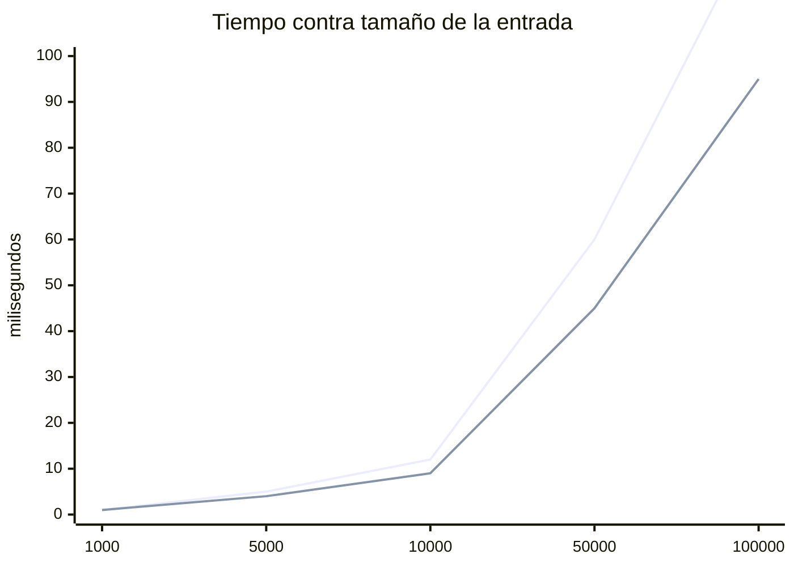

# Informe final

## 1. El escenario y el modelado

Nuestro escenario corresponde al inventario de una tienda, el cual puede ser usado por el encargado para poder llevar un control de manera correcta sobre sus productos.
La información que este maneja y guarda es: un código único que identifica a cada producto para que no se confunda con algún otro, el nombre del artículo y por último la cantidad que haya de ese producto. 

Este inventario resuelve muchas situaciones que serían complicadas de afrontar si en la tienda no se tiene una herramienta que permita llevar el control de los artículos disponibles en esta. Por ejemplo, cuando llega mercancía nueva, se agota un producto o un cliente pregunta si hay existencias de alguno, entre muchas otras.

El programa se comunica de manera que el usuario le otorga unas órdenes, en donde debe colocar unos parámetros específicos y este responde con algunos textos de acuerdo a lo que se le haya pedido. Los detalles están en el siguiente numeral. 

Casi todas las operaciones del inventario (como consultar, reponer, eliminar e incluso agregar, que debe detectar códigos repetidos) comienzan por encontrar el artículo a partir de su código. Cuando el inventario tiene pocos artículos no hay ningún problema, sin embargo, al escalarlo con miles de artículos el costo de buscar predomina sobre todo lo demás. Por esta razón, el proyecto resuelve el mismo problema con dos estructuras: en primer lugar, una lista enlazada simple, donde buscar recorre los nodos, y en segundo lugar, una tabla hash con encadenamiento, que reparte los artículos en cubetas para buscar solo en una de ellas. Además se mide `std::unordered_map` como referencia de una implementación de la biblioteca estándar.

Las dos estructuras reciben las mismas órdenes y por eso deben responder lo mismo con igual entrada, de manera que sea posible medirlas con un solo programa y así comparar sus salidas. La única diferencia esperada es el orden en que sale `listar`, que depende de la estructura y se explica en la sección de la tabla hash.

## 2. Las dos estructuras

Cada artículo del inventario guarda tres datos: su código (debe ser entero positivo único), su nombre (una palabra sin espacios, de a lo sumo 63 caracteres) y su cantidad (también entera positiva).

Las dos estructuras guardan esos mismos artículos, pero organizados
de forma distinta:

- **Lista enlazada simple:** cada nodo guarda un artículo y un
  puntero al siguiente nodo; la estructura guarda un puntero al primero
  (`cabeza`) y el número de artículos $n$.
- **Tabla hash con encadenamiento:** un arreglo de $m$
  cubetas, donde cada cubeta es una lista enlazada como la del avance, y el número total de artículos n de toda la tabla. La función que decide en qué cubeta va cada código se describe en la sección 3.

Las operaciones son las mismas en las dos estructuras:

| Operación | Qué hace | Precondición |
|---|---|---|
| Agregar (id, nombre, cantidad) | Añade un producto al inventario, con su id, nombre y cantidad. Responde `ok` si se añadió, o `repetido` si el artículo ya estaba o `invalido` si se coloca una cantidad o codigo no positivos. | $\text{id} > 0$; nombre no vacío, sin espacios, de a lo sumo 63 caracteres (cabe en `char nombre[64]`); $\text{cantidad} > 0$ |
| Eliminar (id) | Quita el artículo con ese id del inventario. Responde `ok` si se eliminó, o `no existe` si no estaba. | Inventario no vacío ($n \geq 1$) e $\text{id} > 0$, ya que con el inventario vacío no hay nada que quitar. |
| Consultar (id) | Muestra el artículo con ese id: responde con su id, nombre y cantidad, o con `no existe` si no está. No modifica nada. |  Inventario no vacío ($n \geq 1$) e $\text{id} > 0$. |
| Reponer (id, cantidad) | Aumenta la cantidad de un artículo que ya está en el inventario. Responde `ok` si se repuso, o `no existe` si el artículo no está o `invalido` si se coloca una cantidad o codigo no positivos. | Inventario no vacío ($n \geq 1$), $\text{id} > 0$ y $\text{cantidad} > 0$, puesto que con cantidad negativa reponer restaría existencias. |
| Listar | Muestra todos los artículos del inventario, uno por línea. No modifica nada. | Ninguna. Con el inventario vacío no muestra nada. |

Las dos estructuras, y también el envoltorio de `std::unordered_map` que se usa como referencia, ofrecen las mismas operaciones con las mismas firmas, es decir la misma interfaz. 
Esto sucede debido a que el programa que mide los tiempos debe poder usar una u otra sin cambiar y si las interfaces fueran distintas, el programa de medición tendría que tratar cada estructura de forma diferente, y una diferencia en los tiempos podría deberse a ese código como tal y no a la estructura. Entonces, por esta razón, con una sola interfaz lo único que cambia entre una medición y otra es la estructura, y por eso las diferencias medidas pueden ser atribuidas a ella. 

Por otra parte, también ayuda al diseño puesto que, como cada cubeta de la tabla es una lista del avance, la tabla elige la cubeta con la función hash y delega en ella la operación.

Es justamente por lo anterior que las precondiciones realizadas en primer lugar valen para las dos estructuras. En la tabla, "inventario no vacío" significa $n \geq 1$ para toda la tabla, no para una cubeta: una cubeta puede estar vacía aunque la tabla no lo esté.

Lo único que si varía entre las estructuras es su construcción, ya que la tabla necesita el número de cubetas. 

**Casos especiales:**

- Si una precondición no se cumple, la estructura no se modifica. Con el inventario vacío, `ELIMINAR`, `CONSULTAR` responden `no existe`, como está en el enunciado, en cambio `REPONER` responde `invalido`.

- Para el nombre en agregar, si se pasa de 63 carácteres el programa trunca el sobrante, es decir, descarta todos los carácteres que no estén dentro de ese espacio de 63 y el resto de la palabra no afecta a las órdenes siguientes.

- Si `AGREGAR` o `REPONER` reciben un código o una cantidad que no son positivos, la orden responde `invalido` y no modifica la estructura. La respuesta es la misma en las dos estructuras y se menciona anteriormente en la tabla.

## 3. Análisis formal de complejidad

Una demostración por operación no trivial, en cuatro partes:

**Teorema.** (Enunciado con la cota.)

**Demostración.** Se procede de forma directa. (La estrategia.)

*Desarrollo.* (La cadena de desigualdades, con la justificación de cada
paso.)

$$T(n) = \ldots \leq c \cdot n^2 \quad \text{para todo } n \geq k$$

*Conclusión.* Por lo tanto, $T(n) \in O(n^2)$ con testigos $c = \ldots$
y $k = \ldots$

Resumen de costos:

| Operación | Desde cero | De la biblioteca | Por qué |
|---|---|---|---|
|  |  |  |  |

## 4. Experimentos

Máquina, compilador y banderas con que se midió; cómo se generaron las
entradas; cuántas repeticiones por tamaño.

| $n$ | desde cero (ms) | biblioteca (ms) |
|---|---|---|
| 1000 |  |  |
| 5000 |  |  |
| 10000 |  |  |
| 50000 |  |  |
| 100000 |  |  |

## 5. Lo medido contra lo predicho

(¿Coincide la curva con la cota? Donde no coincida, expliquen por qué:
la constante oculta, la memoria caché, el crecimiento del vector.)

## 6. Conclusiones

(Cuál estructura conviene para este escenario y bajo qué condiciones
cambiaría la respuesta.)
