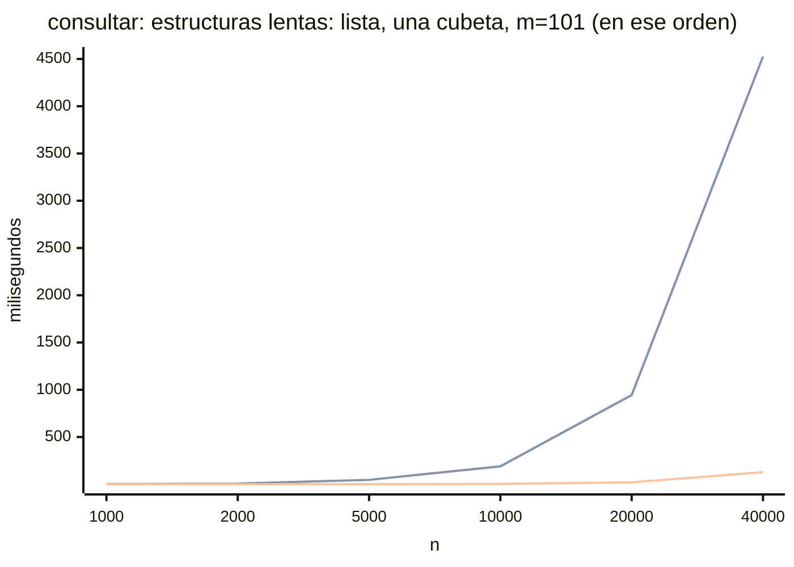
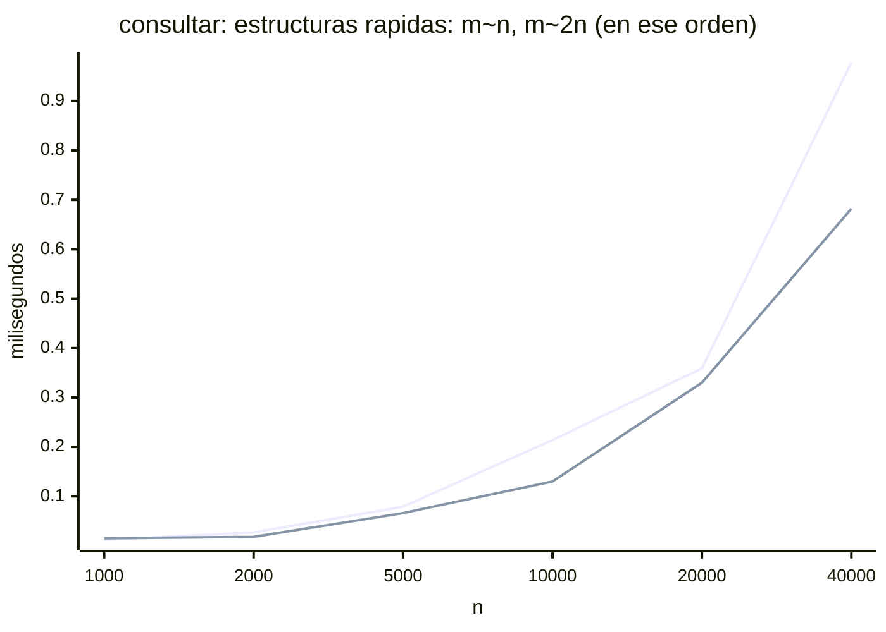
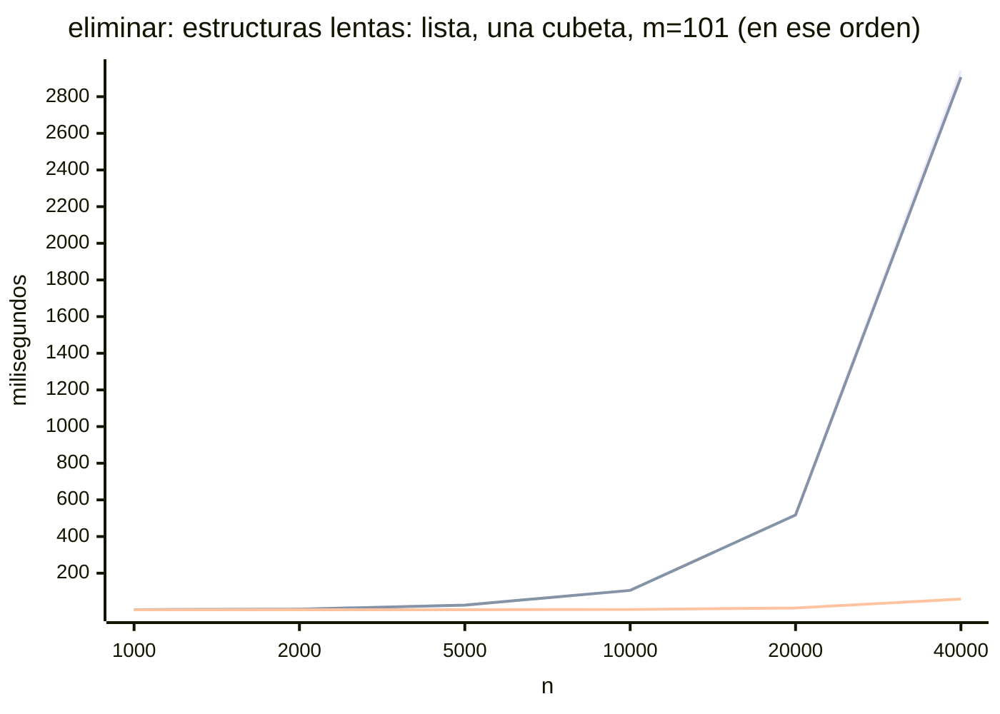
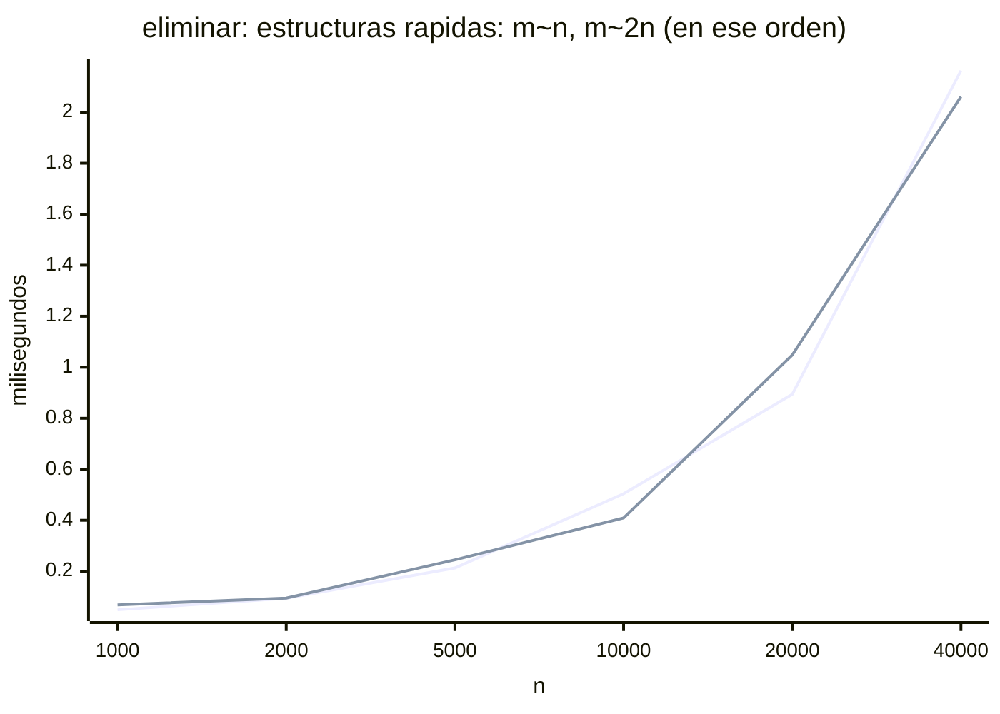

# Informe final

## 1. El escenario y el modelado

Nuestro escenario corresponde al inventario de una tienda, el cual puede ser usado por el encargado para poder llevar un control de manera correcta sobre sus productos.
La información que este maneja y guarda es: un código único que identifica a cada producto para que no se confunda con algún otro, el nombre del artículo y por último la cantidad que haya de ese producto. 

Este inventario resuelve muchas situaciones que serían complicadas de afrontar si en la tienda no se tiene una herramienta que permita llevar el control de los artículos disponibles en esta. Por ejemplo, cuando llega mercancía nueva, se agota un producto o un cliente pregunta si hay existencias de alguno, entre muchas otras.

El programa se comunica de manera que el usuario le otorga unas órdenes, en donde debe colocar unos parámetros específicos y este responde con algunos textos de acuerdo a lo que se le haya pedido. Los detalles están en el siguiente numeral. 

Casi todas las operaciones del inventario (como consultar, reponer, eliminar e incluso agregar, que debe detectar códigos repetidos) comienzan por encontrar el artículo a partir de su código. Cuando el inventario tiene pocos artículos no hay ningún problema, sin embargo, al escalarlo con miles de artículos el costo de buscar predomina sobre todo lo demás. Por esta razón, el proyecto resuelve el mismo problema con dos estructuras: en primer lugar, una lista enlazada simple, donde buscar recorre los nodos, y en segundo lugar, una tabla hash con encadenamiento, que reparte los artículos en cubetas para buscar solo en una de ellas. Además se mide `std::unordered_map` como referencia de una implementación de la biblioteca estándar.

Las dos estructuras reciben las mismas órdenes y por eso deben responder lo mismo con igual entrada, de manera que sea posible medirlas con un solo programa y así comparar sus salidas. La única diferencia esperada es el orden en que sale `listar`, que depende de la estructura y se explica en la sección de la tabla hash.

## 2. Las dos estructuras

Cada artículo del inventario guarda tres datos: su código (debe ser entero positivo único), su nombre (una palabra sin espacios, de a lo sumo 63 caracteres) y su cantidad (también entera positiva).

Las dos estructuras guardan esos mismos artículos, pero organizados
de forma distinta:

- **Lista enlazada simple:** cada nodo guarda un artículo y un
  puntero al siguiente nodo; la estructura guarda un puntero al primero
  (`cabeza`) y el número de artículos $n$.
- **Tabla hash con encadenamiento:** un arreglo de $m$
  cubetas, donde cada cubeta es una lista enlazada como la del avance, y el número total de artículos n de toda la tabla. La función que decide en qué cubeta va cada código se describe en la sección 3.

Las operaciones son las mismas en las dos estructuras:

| Operación | Qué hace | Precondición |
|---|---|---|
| Agregar (id, nombre, cantidad) | Añade un producto al inventario, con su id, nombre y cantidad. Responde `ok` si se añadió, o `repetido` si el artículo ya estaba o `invalido` si se coloca una cantidad o codigo no positivos. | $\text{id} > 0$; nombre no vacío, sin espacios, de a lo sumo 63 caracteres (cabe en `char nombre[64]`); $\text{cantidad} > 0$ |
| Eliminar (id) | Quita el artículo con ese id del inventario. Responde `ok` si se eliminó, o `no existe` si no estaba. | Inventario no vacío ($n \geq 1$) e $\text{id} > 0$, ya que con el inventario vacío no hay nada que quitar. |
| Consultar (id) | Muestra el artículo con ese id: responde con su id, nombre y cantidad, o con `no existe` si no está. No modifica nada. |  Inventario no vacío ($n \geq 1$) e $\text{id} > 0$. |
| Reponer (id, cantidad) | Aumenta la cantidad de un artículo que ya está en el inventario. Responde `ok` si se repuso, o `no existe` si el artículo no está o `invalido` si se coloca una cantidad o codigo no positivos. | Inventario no vacío ($n \geq 1$), $\text{id} > 0$ y $\text{cantidad} > 0$, puesto que con cantidad negativa reponer restaría existencias. |
| Listar | Muestra todos los artículos del inventario, uno por línea. No modifica nada. | Ninguna. Con el inventario vacío no muestra nada. |

Las dos estructuras, y también el envoltorio de `std::unordered_map` que se usa como referencia, ofrecen las mismas operaciones con las mismas firmas, es decir la misma interfaz. 
Esto sucede debido a que el programa que mide los tiempos debe poder usar una u otra sin cambiar y si las interfaces fueran distintas, el programa de medición tendría que tratar cada estructura de forma diferente, y una diferencia en los tiempos podría deberse a ese código como tal y no a la estructura. Entonces, por esta razón, con una sola interfaz lo único que cambia entre una medición y otra es la estructura, y por eso las diferencias medidas pueden ser atribuidas a ella. 

Por otra parte, también ayuda al diseño puesto que, como cada cubeta de la tabla es una lista del avance, la tabla elige la cubeta con la función hash y delega en ella la operación.

Es justamente por lo anterior que las precondiciones realizadas en primer lugar valen para las dos estructuras. En la tabla, "inventario no vacío" significa $n \geq 1$ para toda la tabla, no para una cubeta: una cubeta puede estar vacía aunque la tabla no lo esté.

Lo único que si varía entre las estructuras es su construcción, ya que la tabla necesita el número de cubetas. 

**Casos especiales:**

- Si una precondición no se cumple, la estructura no se modifica. Con el inventario vacío, `ELIMINAR`, `CONSULTAR` responden `no existe`, como está en el enunciado, en cambio `REPONER` responde `invalido`.

- Para el nombre en agregar, si se pasa de 63 carácteres el programa trunca el sobrante, es decir, descarta todos los carácteres que no estén dentro de ese espacio de 63 y el resto de la palabra no afecta a las órdenes siguientes.

- Si `AGREGAR` o `REPONER` reciben un código o una cantidad que no son positivos, la orden responde `invalido` y no modifica la estructura. La respuesta es la misma en las dos estructuras y se menciona anteriormente en la tabla.

## 3. Análisis formal de complejidad

### Modelo de costo

Contamos operaciones elementales: cada comparación, asignación, operación
aritmética, evaluación de un `assert`, llamada a `free` y retorno cuesta una
unidad. Como en el avance, los nombres tienen longitud acotada (63
caracteres) y las operaciones sobre enteros cuestan una constante. $n$ es el
número de artículos guardados, $m$ el número de cubetas de la tabla,
$\alpha = n/m$ su factor de carga y $k_b$ el número de artículos de la cubeta
$b$.

Usamos la notación del avance: $v_i$ es el nodo en la posición $i$ y $c_i$ su
código, con $v_0 = \mathrm{cabeza}$. Por convención, $v_n = \mathrm{nullptr}$
y $v_{-1} = \mathrm{nullptr}$.

### Consultar y reponer en la lista

**Teorema.** `consultar` y `reponer` tienen tiempo de peor caso $O(n)$ y espacio auxiliar $O(1)$.

**Estrategia.** Las dos operaciones llaman a `buscar`. Cuando se encuentra el producto, `consultar` copia sus datos a `salida` y `reponer` suma unidades a la cantidad existente. Como el registro tiene tamaño fijo, ambas acciones cuestan tiempo constante.

**Desarrollo.** Sea $x$ el código solicitado. Después de $j$ avances, el invariante de `buscar` es:

$$
0\le j\le n,\qquad
\mathrm{actual}=v_j,\qquad
\forall i\in\{0,\ldots,j-1\},\ c_i\ne x.
$$

Al inicio, $j=0$ y `actual` apunta a `cabeza`. Cada avance ocurre porque el nodo actual existe y su código no coincide. Por eso el invariante se conserva al pasar al nodo siguiente. Si el código no aparece, se llega a $v_n$, que es `nullptr`.

Cada avance cuesta como máximo tres unidades: dos comparaciones y una asignación. Fuera del ciclo, `buscar` usa hasta cuatro unidades: la asignación inicial, la evaluación final de la condición y el retorno. La operación que llama a `buscar` usa hasta diez unidades adicionales para las validaciones, las asignaciones, la decisión, la copia o la suma, y el retorno. Por tanto:

$$
T_L(n)\le 3j+14\le 3n+14\le 17n
\qquad \text{para } n\ge 1.
$$

**Conclusión.** Los testigos son $c=17$ y $k=1$. Si el código no existe, se recorren los $n$ nodos, de modo que el peor caso es $\Theta(n)$. Si está en el primer nodo, el tiempo es $O(1)$. El espacio auxiliar es $O(1)$ porque la cantidad de variables no crece con $n$.

### Consultar y reponer en la tabla hash

**Teorema.** Ambas operaciones cuestan $O(1+k_b)$, donde $k_b$ es la cantidad de productos en la cubeta del código. Su peor caso es $O(n)$ y su espacio auxiliar es $O(1)$.

**Estrategia.** La tabla calcula la cubeta con $b=x\bmod m$. Si está vacía, devuelve `false`. Si contiene productos, delega en `consultar` o `reponer` de esa lista.

**Desarrollo.** El cálculo del índice, el acceso a la cubeta, la comprobación de si está vacía y el manejo del resultado requieren una cantidad fija de operaciones, acotada por 14 unidades en este modelo. Si la cubeta no está vacía, se aplica la cota de la lista con $k_b$ en vez de $n$. Si está vacía, se omite esa llamada. Como $k_b\le n$:

$$
T_H(n,m)\le 14+(3k_b+14)\le 3n+28\le 31n
\qquad \text{para } n\ge 1.
$$

**Conclusión.** Para el peor caso, los testigos son $c=31$ y $k=1$. Si todos los códigos caen en una sola cubeta, la búsqueda puede recorrer los $n$ productos. Bajo la hipótesis de distribución uniforme, el tamaño esperado de la cubeta consultada es a lo sumo $1+\alpha$, por lo que el tiempo esperado es $O(1+\alpha)$, con $\alpha=n/m$. Consultar no cambia el inventario y reponer solo cambia la cantidad del producto encontrado.

### Agregar en la lista y en la tabla hash

**Teorema.** `Lista::agregar` cuesta $O(n)$ en el peor caso. `TablaHash::agregar` cuesta $O(1+k_b)$ y su peor caso es $O(n)$. El espacio auxiliar es $O(1)$ en ambas.

**Estrategia.** La lista busca el código para impedir duplicados. Si el código no existe y se puede reservar memoria, copia el nombre y enlaza el nodo al principio. La tabla calcula la cubeta y delega la inserción en su lista.

**Desarrollo.** La búsqueda en la lista cuesta a lo sumo $3n+4$. El resto se acota con una constante $A$: se reserva un nodo de tamaño fijo, se copian hasta 63 caracteres y se actualizan los enlaces y el contador. Sea $H$ la cota constante del trabajo propio de la tabla: calcular el índice, seleccionar la cubeta y actualizar el contador si la inserción tiene éxito.

$$
T_{L,\mathrm{agregar}}(n)\le 3n+4+A
\le (7+A)n
\qquad \text{para } n\ge 1.
$$

$$
T_{H,\mathrm{agregar}}(n,m)\le H+3k_b+4+A
\le (7+A+H)n
\qquad \text{para } n\ge 1.
$$

**Conclusión.** Los testigos son $c=7+A$, $k=1$ para la lista y $c=7+A+H$, $k=1$ para la tabla. En la tabla, con distribución uniforme, el tiempo esperado es $O(1+\alpha)$. Una inserción exitosa añade un nodo al inventario; si el código está repetido, no se añade ninguno.

### Listar en la lista y en la tabla hash

**Teorema.** `Lista::listar` cuesta $\Theta(n)$ para $n\ge 1$, y `TablaHash::listar` cuesta $\Theta(m+n)$. Ambas usan espacio auxiliar $O(1)$.

**Estrategia.** La lista visita cada nodo e imprime su producto. La tabla recorre todas las cubetas, incluso las vacías, y llama a `listar` sobre cada una. Emitir una línea tiene costo acotado porque los nombres tienen longitud máxima y los campos numéricos son de tamaño fijo.

**Desarrollo.** En la lista, después de $j$ iteraciones se han impreso los primeros $j$ productos y `actual` apunta a $v_j$. Si $A_L$ acota el trabajo fijo y $B_L$ el trabajo por nodo, entonces:

$$
T_{L,\mathrm{listar}}(n)\le A_L+B_Ln
\le (A_L+B_L)n
\qquad \text{para } n\ge 1.
$$

En la tabla, tras procesar las primeras $i$ cubetas se han impreso $\sum_{b=0}^{i-1}k_b$ productos. Al terminar, se han visitado las $m$ cubetas y se han impreso $\sum_{b=0}^{m-1}k_b=n$ productos. Si $A_H$ acota el trabajo fijo y $B_H$ el trabajo por cubeta, incluido el costo fijo de llamar a su lista, entonces:

$$
T_{H,\mathrm{listar}}(n,m)\le A_H+B_Hm+B_Ln
\le (A_H+B_H+B_L)(m+n)
\qquad \text{para } m+n\ge 1.
$$

**Conclusión.** Los testigos son $c=A_L+B_L$, $k=1$ para la lista y $c=A_H+B_H+B_L$, $k=1$ para la tabla, tomando $m+n$ como tamaño. Las cotas son ajustadas porque la lista visita todos sus nodos y la tabla, además, visita todas las cubetas. Una lista vacía termina en tiempo constante. Ninguna de las dos operaciones cambia el inventario.

### Eliminar en la lista

`Lista::eliminar` avanza con dos punteros, `anterior` y `muerto`, hasta
encontrar el código o llegar al final. Si lo encuentra, reenlaza y libera el
nodo.

**Invariante del ciclo.** Cada vez que se evalúa la condición del `while`,
después de $j$ iteraciones completas:

$$
0 \le j \le n \quad\land\quad \mathrm{muerto} = v_j \quad\land\quad \mathrm{anterior} = v_{j-1} \quad\land\quad \forall i \in \{0,\ldots,j-1\},\ c_i \neq \mathrm{codigo}.
$$

Al empezar, $j = 0$: `muerto` es `cabeza` $= v_0$, `anterior` es
`nullptr` $= v_{-1}$, y el cuantificador recorre un conjunto vacío, así que se
cumple. Una iteración solo ocurre si $c_j \neq \mathrm{codigo}$, y avanza los
dos punteros una posición, así que el invariante se conserva con $j + 1$. La
cantidad $n - j$ disminuye en cada iteración y nunca es negativa, por lo que
el ciclo termina.

Al salir, o bien $\mathrm{muerto} = \mathrm{nullptr}$, entonces $j = n$ y por
el invariante ningún nodo tenía el código; o bien `muerto` es el nodo $v_j$
con $c_j = \mathrm{codigo}$ y `anterior` es justo $v_{j-1}$, el nodo que hay
que reenlazar.

**Efecto sobre los invariantes de la lista.** Si el código estaba en la
posición $p$, la lista queda con $n' = n - 1$ nodos:

$$
v'_i = v_i \ \text{ para } 0 \le i < p, \qquad v'_i = v_{i+1} \ \text{ para } p \le i < n - 1.
$$

Los nodos que quedan conservan su orden y sus enlaces, ningún código se
repite porque solo se quitó uno, y si $p = 0$ la nueva `cabeza` es $v_1$ (o
`nullptr` si la lista queda vacía). Por eso se siguen cumpliendo los tres
invariantes del avance.

**Teorema.** El tiempo de `Lista::eliminar` cumple
$T^{L}_{\text{elim}}(n) \in O(n)$.

**Demostración.** Se procede de forma directa: se cuentan las operaciones
antes del ciclo, en cada iteración y después del ciclo, y el número de
iteraciones se acota con el invariante.

*Desarrollo.* Antes del ciclo hay dos `assert` y dos asignaciones (`anterior`
y `muerto`): 4 unidades. Cada iteración evalúa las dos comparaciones de la
condición y hace dos asignaciones: 4 unidades. La evaluación final de la
condición cuesta a lo sumo 2. Después del ciclo, en el camino más largo
(código encontrado): calcular y asignar `encontrado` (2), el `if` (1), la
comparación de `anterior` con `nullptr` (1), el reenlace (1), `free` (1), la
resta y asignación de `n` (2) y el retorno (1): a lo sumo 9. Por el
invariante, $j \le n$:

$$
T^{L}_{\text{elim}}(n) \le 4 + 4j + 2 + 9 \le 4n + 15 \le 4n + 15n = 19n \quad \text{para todo } n \geq 1.
$$

El último paso usa que $15 \le 15n$ cuando $n \ge 1$.

*Conclusión.* Por lo tanto, $T^{L}_{\text{elim}}(n) \in O(n)$ con testigos
$c = 19$ y $k = 1$. La cota es ajustada: si el código no está, el ciclo hace
las $n$ iteraciones y $T^{L}_{\text{elim}}(n) \ge 4n$, así que el peor caso
es $\Theta(n)$. El mejor caso, el código en `cabeza`, es $O(1)$. El espacio
auxiliar es $O(1)$: dos punteros y un booleano.

### Eliminar en la tabla hash

`TablaHash::eliminar` calcula $b = h(\mathrm{codigo}) = \mathrm{codigo} \bmod m$,
revisa que la cubeta $b$ no esté vacía y delega en `Lista::eliminar` sobre esa
cubeta, que tiene $k_b$ artículos.

**Efecto sobre los invariantes de la tabla.** Sea $E \in \{0, 1\}$ igual a 1
si se eliminó el artículo. Al terminar:

$$
\mathrm{numeroArticulos}' = \mathrm{numeroArticulos} - E \quad\land\quad \mathrm{numeroArticulos}' = \sum_{i=0}^{m-1} k'_i \quad\land\quad \forall i \neq b,\ k'_i = k_i.
$$

Solo cambia la cubeta $b$, que pierde exactamente $E$ nodos, y el contador
baja solo cuando `cubeta.eliminar` devuelve `true`. Las demás cubetas no se
tocan, así que sigue cumpliéndose que todo nodo de la cubeta $i$ tiene código
$c$ con $h(c) = i$.

**Teorema (peor caso).** El tiempo de `TablaHash::eliminar` cumple
$T^{H}_{\text{elim}}(n) \in O(n)$.

**Demostración.** Se procede de forma directa: se cuenta el trabajo propio de
la tabla, que es constante, y se le suma el costo de `Lista::eliminar` sobre
una sola cubeta, que es el teorema anterior con $n$ cambiado por $k_b$.

*Desarrollo.* Las operaciones propias de la tabla son: dos `assert` (2), la
asignación de `eliminado` (1), `indice` (dos `assert`, el residuo, la
asignación y el retorno: 5), tomar la referencia a la cubeta (1), `vacia()`
de la cubeta (comparación y retorno: 2), la negación y el `if` (1), asignar
el resultado (1), el `if (eliminado)` (1), el decremento (2) y el retorno (1):
en total a lo sumo 17. Por el teorema anterior, `Lista::eliminar` sobre la
cubeta cuesta a lo sumo $4k_b + 15$, y una cubeta no puede tener más
artículos que toda la tabla, $k_b \le n$:

$$
T^{H}_{\text{elim}}(n) \le 17 + 4k_b + 15 \le 4n + 32 \le 4n + 32n = 36n \quad \text{para todo } n \geq 1.
$$

*Conclusión.* Por lo tanto, $T^{H}_{\text{elim}}(n) \in O(n)$ con testigos
$c = 36$ y $k = 1$. La cota se alcanza cuando todos los códigos caen en la
misma cubeta ($k_b = n$): la tabla se comporta como la lista. Es el
experimento «una cubeta» de la sección 4.

**Teorema (caso esperado).** Bajo la hipótesis de hashing uniforme (cada
código cae en cualquiera de las $m$ cubetas con probabilidad $1/m$, de forma
independiente de los demás), el tiempo esperado de `TablaHash::eliminar`
cumple $E\!\left[T^{H}_{\text{elim}}\right] \in O(1 + \alpha)$. Si además
$m \ge n$, entonces $E\!\left[T^{H}_{\text{elim}}\right] \in O(1)$.

**Demostración.** Se procede de forma directa: se acota el tamaño esperado de
la cubeta $b$ y se usa que la cota del costo es lineal en $k_b$.

*Desarrollo.* Si el código está en la tabla, la cubeta $b$ contiene ese
artículo y cada uno de los otros $n - 1$ con probabilidad $1/m$. Si no está,
contiene cada uno de los $n$ con probabilidad $1/m$. En los dos casos:

$$
E[k_b] \le 1 + \frac{n - 1}{m} \le 1 + \frac{n}{m} = 1 + \alpha.
$$

Como $T^{H}_{\text{elim}} \le 4k_b + 32$ y la esperanza es lineal:

$$
E\!\left[T^{H}_{\text{elim}}\right] \le 4\,E[k_b] + 32 \le 4(1 + \alpha) + 32 = 36 + 4\alpha \le 36(1 + \alpha).
$$

Si $m \ge n$, entonces $\alpha \le 1$ y

$$
E\!\left[T^{H}_{\text{elim}}\right] \le 36 + 4 = 40 \le 40 \cdot 1 \quad \text{para todo } n \geq 1.
$$

*Conclusión.* Por lo tanto, $E\!\left[T^{H}_{\text{elim}}\right] \in O(1 + \alpha)$
con testigos $c = 36$ y $k = 1$, y con $m \ge n$ (las configuraciones
$m \approx n$ y $m \approx 2n$ de los experimentos) es $O(1)$ con $c = 40$ y
$k = 1$. El espacio auxiliar es $O(1)$: la referencia a la cubeta, un booleano
y los dos punteros de `Lista::eliminar`. Este resultado coincide con el
análisis del encadenamiento en Cormen, Leiserson, Rivest y Stein,
*Introduction to Algorithms*, 4.ª edición, MIT Press, 2022, capítulo 11,
sección 11.2.

### Análisis de espacio

Sean $s_N$, $s_L$ y $s_H$ los tamaños en bytes de `Nodo`, `Lista` y
`TablaHash`, que el compilador fija y no dependen de $n$. En la máquina de los
experimentos, con `sizeof`: $s_N = 88$ (el `Producto` ocupa 80: 8 del código,
64 del nombre, 4 de la cantidad y 4 de relleno; más 8 del puntero), $s_L = 16$
y $s_H = 16$. Contamos los bytes que reserva cada estructura; el encabezado
que `malloc` agrega a cada bloque es otra constante por nodo y no cambia las
cotas.

**Teorema.** El espacio de la lista con $n \ge 1$ artículos cumple
$S^{L}(n) \in O(n)$.

**Demostración.** Se procede de forma directa: la lista guarda el objeto
`Lista` y exactamente un nodo por artículo.

*Desarrollo.*

$$
S^{L}(n) = s_L + s_N\, n = 16 + 88n \le 16n + 88n = 104n \quad \text{para todo } n \geq 1.
$$

*Conclusión.* Por lo tanto, $S^{L}(n) \in O(n)$ con testigos $c = 104$ y
$k = 1$. Como además $S^{L}(n) \ge 88n$, el espacio es $\Theta(n)$.

**Teorema.** El espacio de la tabla con $n$ artículos y $m$ cubetas cumple
$S^{H}(n, m) \in O(n + m)$; si $m \le 4n$, $S^{H}(n) \in O(n)$.

**Demostración.** Se procede de forma directa: la tabla guarda el objeto
`TablaHash`, el arreglo de $m$ objetos `Lista` (uno por cubeta, aunque esté
vacía) y un nodo por artículo.

*Desarrollo.*

$$
S^{H}(n, m) = s_H + s_L\, m + s_N\, n = 16 + 16m + 88n \le 104(n + m) \quad \text{para todo } n + m \geq 1.
$$

En los experimentos $m$ es 101, el primo $\ge n$ o el primo $\ge 2n$. Por el
postulado de Bertrand siempre hay un primo entre $2n$ y $4n$, así que en los
tres casos $m \le 4n$ (para $n \ge 26$ en el caso $m = 101$), y entonces

$$
S^{H}(n) \le 16 + 16 \cdot 4n + 88n = 152n + 16 \le 168n \quad \text{para todo } n \geq 1.
$$

*Conclusión.* Por lo tanto, $S^{H}(n, m) \in O(n + m)$ con testigos $c = 104$
y $k = 1$, y con $m \le 4n$ es $O(n)$ con $c = 168$ y $k = 1$. Frente a la
lista, la tabla gasta $16m$ bytes más: es el precio de tener cubetas vacías.

Para `map`, la biblioteca estándar de g++ (libstdc++) usa un árbol
rojo-negro: cada artículo ocupa un nodo con tres punteros y el color, más el
par clave-producto. También es $\Theta(n)$, con una constante por artículo
mayor que la de nuestros nodos.

Resumen de costos:

| Operación | Desde cero | De la biblioteca | Por qué |
|---|---|---|---|
| Consultar y reponer, lista | $O(n)$ peor caso | $O(\log n)$ | Se busca el código y luego se copia o actualiza el producto. |
| Consultar y reponer, tabla | $O(1+\alpha)$ esperado; $O(n)$ peor caso | $O(\log n)$ | Solo se busca en la cubeta del código. |
| Agregar, lista | $O(n)$ peor caso | $O(\log n)$ | Se detectan códigos repetidos antes de insertar. |
| Agregar, tabla | $O(1+\alpha)$ esperado; $O(n)$ peor caso | $O(\log n)$ | Se comprueban los duplicados en una sola cubeta. |
| Listar, lista | $\Theta(n)$ | $\Theta(n)$ | Se imprime cada producto. |
| Listar, tabla | $\Theta(m+n)$ | $\Theta(n)$ | Se recorren todas las cubetas y se imprime cada producto. |
| Eliminar, lista | $O(n)$ peor caso | $O(\log n)$ | La lista recorre hasta el nodo y su anterior; `map` baja por un árbol balanceado de altura $O(\log n)$. |
| Eliminar, tabla | $O(1 + \alpha)$ esperado, $O(n)$ peor caso | $O(\log n)$ | La tabla solo recorre la cubeta del código; si todos caen en la misma cubeta, recorre todos. |
| Espacio, lista | $\Theta(n)$ | $\Theta(n)$ | Un nodo por artículo. |
| Espacio, tabla | $\Theta(n + m)$ | $\Theta(n)$ | Un nodo por artículo más el arreglo de $m$ cubetas, aunque estén vacías. |

## 4. Experimentos

### 4.1 Pruebas de corrección

Antes de medir, verificamos que las dos estructuras respondan lo mismo con la
misma entrada. `make pruebas` corre cada caso de `datos/` con el programa de la
lista y con el de la tabla (1009 cubetas). Como `LISTAR` sale en orden
distinto en cada estructura, los casos con `LISTAR` tienen además un archivo
`nombre.tabla.out` con la salida esperada de la tabla.

Además de los casos del avance, agregamos tres casos pensados para la tabla:

| Caso | Tipo | Qué verifica |
|---|---|---|
| 07 | funcional | Eliminar con colisiones: 5, 1014 y 2023 caen en la cubeta 5; elimina en medio de la cadena, repite una eliminación y elimina un código cuya cubeta está vacía aunque la tabla no lo esté. |
| 08 | límite | Bordes del índice: 1009 (cubeta 0), 1008 (cubeta $m-1$) y 2018 (cubeta 0 otra vez); vacía la tabla, consulta y elimina sobre ella vacía y vuelve a agregar. |
| 09 | límite | Eliminar con códigos no positivos (`0` y `-5`) con el inventario lleno: responde `no existe` sin modificar nada. En la tabla esto evita un índice negativo, porque el residuo de un número negativo es negativo. Luego elimina los dos productos y repite una eliminación. |

Salida de `make pruebas`:

```
  OK    lista  01_ejemplo_enunciado.in
  OK    lista  02_agregar_listar.in
  OK    lista  03_consultar_reponer.in
  OK    lista  04_eliminar.in
  OK    lista  05_limite_vacio.in
  FALLA lista  06_limite_borde.in
  OK    lista  07_eliminar_colisiones.in
  OK    lista  08_limite_tabla.in
  OK    lista  09_limite_eliminar.in
  OK    tabla  01_ejemplo_enunciado.in
  FALLA tabla  02_agregar_listar.in
  OK    tabla  03_consultar_reponer.in
  OK    tabla  04_eliminar.in
  OK    tabla  05_limite_vacio.in
  FALLA tabla  06_limite_borde.in
  OK    tabla  07_eliminar_colisiones.in
  OK    tabla  08_limite_tabla.in
  OK    tabla  09_limite_eliminar.in
```

### 4.2 Cómo se midió

**Máquina.** Pendiente: procesador, memoria RAM, sistema operativo y la
salida de `g++ --version`. Todas las mediciones se hicieron en esa misma
máquina, compilando con `g++ -Wall -Wextra -O2`.

**Qué se mide.** El programa `codigo/medir.cpp` toma $n$ códigos distintos y,
sobre una estructura vacía, mide por separado tres fases: agregar los $n$
artículos, consultarlos todos y eliminarlos todos. Las consultas y las
eliminaciones van en un orden aleatorio distinto al de inserción. Igual que
`principal.cpp`, la medición es una plantilla que solo usa la interfaz común,
y `main` construye la estructura. La columna `encontrados` cuenta las
consultas que respondieron que el artículo estaba y debe ser $n$: así
verificamos que cada estructura funciona mientras se mide.

**Entradas.** Los códigos se generan con semilla fija (2026), así que las tres
estructuras reciben exactamente la misma entrada:

- *Aleatorio:* $n$ códigos distintos al azar entre $1$ y $10^9$.
- *Una cubeta:* los códigos $m, 2m, \dots, nm$, que tienen residuo 0 y caen
  todos en la cubeta 0. Es el peor caso de la tabla.

**Configuraciones.** Para cada $n \in \{1000, 2000, 5000, 10000, 20000, 40000\}$
medimos: la lista; la tabla con $m = 101$ (tabla pequeña, $\alpha$ crece con
$n$), con $m$ el primo $\ge n$ ($\alpha \approx 1$) y con $m$ el primo
$\ge 2n$ ($\alpha \approx 1/2$); la tabla con todos los códigos en una cubeta;
y `map` como referencia.

**Repeticiones.** Cada configuración se mide 5 veces y se reporta la mediana,
que es menos sensible que el promedio a una repetición interrumpida por el
sistema operativo. Cada repetición corre en un proceso nuevo: si se repite
dentro del mismo programa, los nodos liberados al eliminar en desorden quedan
revueltos en la memoria dinámica, y desde la segunda repetición la lista
recibe nodos dispersos y se ve más lenta por cómo quedó la memoria, no por la
estructura.

### 4.3 Resultados

Mediciones en `datos/mediciones.csv` (mediana de 5 repeticiones; las 5
repeticiones de cada configuración están en `datos/mediciones-crudas.csv`). En
todas las filas `encontrados` $= n$, así que las tres operaciones respondieron
bien en todas las estructuras mientras se medía.

Pendiente: la curva de `map`, que se agrega cuando esté `mapa.h`.

**agregar (ms, mediana de las repeticiones)**

| $n$ | lista | tabla $m=101$ | tabla $m \approx n$ | tabla $m \approx 2n$ | tabla, una cubeta |
|---|---|---|---|---|---|
| 1000 | 1.779 | 0.117 | 0.081 | 0.132 | 2.261 |
| 2000 | 7.718 | 0.235 | 0.160 | 0.149 | 7.472 |
| 5000 | 51.125 | 1.228 | 0.393 | 0.467 | 51.115 |
| 10000 | 200.898 | 3.922 | 1.059 | 0.841 | 200.959 |
| 20000 | 982.331 | 19.241 | 1.490 | 1.886 | 987.260 |
| 40000 | 4537.718 | 118.309 | 4.086 | 3.562 | 4675.888 |

**consultar (ms, mediana de las repeticiones)**

| $n$ | lista | tabla $m=101$ | tabla $m \approx n$ | tabla $m \approx 2n$ | tabla, una cubeta |
|---|---|---|---|---|---|
| 1000 | 1.651 | 0.035 | 0.012 | 0.015 | 1.660 |
| 2000 | 7.131 | 0.104 | 0.027 | 0.018 | 7.313 |
| 5000 | 48.533 | 0.790 | 0.079 | 0.066 | 46.551 |
| 10000 | 189.676 | 3.356 | 0.214 | 0.130 | 189.446 |
| 20000 | 960.943 | 21.066 | 0.359 | 0.330 | 943.317 |
| 40000 | 4531.000 | 128.116 | 0.978 | 0.682 | 4524.860 |

**eliminar (ms, mediana de las repeticiones)**

| $n$ | lista | tabla $m=101$ | tabla $m \approx n$ | tabla $m \approx 2n$ | tabla, una cubeta |
|---|---|---|---|---|---|
| 1000 | 0.729 | 0.070 | 0.049 | 0.068 | 0.718 |
| 2000 | 3.776 | 0.147 | 0.094 | 0.095 | 3.683 |
| 5000 | 25.577 | 0.748 | 0.213 | 0.245 | 26.180 |
| 10000 | 106.270 | 2.070 | 0.504 | 0.409 | 106.109 |
| 20000 | 518.298 | 9.913 | 0.894 | 1.048 | 517.581 |
| 40000 | 2942.360 | 58.907 | 2.163 | 2.061 | 2906.841 |









Las gráficas `xychart-beta` no dibujan leyenda, por eso el título de cada una
dice el orden de sus líneas. Van separadas en estructuras lentas y rápidas
porque, en una sola gráfica, las curvas de la tabla con $m \ge n$ quedarían
pegadas al eje: a $n = 40000$ la lista tarda más de 4 segundos y la tabla menos
de 1 milisegundo.

## 5. Lo medido contra lo predicho

Cada fase hace $n$ operaciones, así que lo medido es el costo **total** de $n$
operaciones. Por la sección 3, eso da:

| Estructura | Costo de una operación | Total de $n$ operaciones |
|---|---|---|
| Lista | $\Theta(n)$ | $\Theta(n^2)$ |
| Tabla, $m \ge n$ | $O(1 + \alpha)$ con $\alpha \le 1$, es decir $O(1)$ | $\Theta(n)$ |
| Tabla, $m = 101$ | $O(1 + n/101)$ | $\Theta(n + n^2/101)$: lineal con $n$ pequeño, cuadrático con $n$ grande |
| Tabla, una cubeta | $\Theta(n)$, peor caso | $\Theta(n^2)$ |

Una forma directa de comparar es ver cuánto se multiplica el tiempo cuando
$n$ crece. Si el total es $\Theta(n^2)$, al pasar de $n$ a $2n$ el tiempo se
multiplica por $4$, y al pasar de $2000$ a $5000$ (factor $2{,}5$) se
multiplica por $2{,}5^2 = 6{,}25$. Si es $\Theta(n)$, se multiplica por $2$ y por
$2{,}5$. Con los tiempos de `consultar`:

| Paso de $n$ | Predicho $\Theta(n^2)$ | Lista | Una cubeta | Predicho $\Theta(n)$ | Tabla $m \approx n$ | Tabla $m \approx 2n$ |
|---|---|---|---|---|---|---|
| $1000 \to 2000$ | $4$ | $4{,}32$ | $4{,}41$ | $2$ | $2{,}25$ | $1{,}20$ |
| $2000 \to 5000$ | $6{,}25$ | $6{,}81$ | $6{,}37$ | $2{,}5$ | $2{,}93$ | $3{,}67$ |
| $5000 \to 10000$ | $4$ | $3{,}91$ | $4{,}07$ | $2$ | $2{,}71$ | $1{,}97$ |
| $10000 \to 20000$ | $4$ | $5{,}07$ | $4{,}98$ | $2$ | $1{,}68$ | $2{,}54$ |
| $20000 \to 40000$ | $4$ | $4{,}72$ | $4{,}80$ | $2$ | $2{,}72$ | $2{,}07$ |

**Lo que coincide.**

- *La lista es cuadrática.* Sus cocientes están cerca de $4$ (y de $6{,}25$
  en el paso de $2000$ a $5000$), como predice $\Theta(n^2)$ para el total
  de $n$ operaciones de costo $\Theta(n)$.
- *La tabla con todos los códigos en una cubeta se comporta igual que la
  lista.* Sus tiempos son casi idénticos en los seis tamaños (por ejemplo,
  $189{,}7$ ms contra $189{,}4$ ms en `consultar` con $n = 10000$). Es el
  peor caso $O(n)$ del teorema de la sección 3: todos los nodos están en la
  misma cadena y la tabla es una lista con un cálculo de índice extra.
- *La tabla con $m \ge n$ crece de forma lineal.* Sus cocientes oscilan
  alrededor de $2$ (y de $2{,}5$), y a $n = 40000$ consultar los $40000$
  códigos tarda menos de $1$ ms, contra $4531$ ms de la lista: más de
  $4600$ veces más rápida. Con $m \approx 2n$ es un poco más rápida que con
  $m \approx n$, porque las cadenas son más cortas ($\alpha \approx 1/2$).
- *La tabla con $m = 101$ pasa de lineal a cuadrática.* Con $n = 1000$
  ($\alpha \approx 10$) está cerca de la tabla grande, pero a medida que $n$
  crece domina el término $n^2/101$: con $n = 40000$ ($\alpha \approx 396$)
  tarda $128$ ms, más de cien veces lo de la tabla con $m \ge n$, aunque
  todavía unas $35$ veces menos que la lista.
- *Las constantes entre operaciones también coinciden.* En la lista,
  `agregar` tarda casi lo mismo que `consultar`, y `eliminar` cerca de la
  mitad. Agregar el artículo $k$ recorre los $k$ ya guardados para detectar
  repetidos, en total $\sum k \approx n^2/2$; consultar visita en promedio la
  mitad de los $n$ nodos, en total $n \cdot n/2 = n^2/2$; y al eliminar la
  lista se va encogiendo, en total $\approx n^2/4$. Medido con
  $n = 20000$: $982$, $961$ y $518$ ms.

**Lo que no coincide, y por qué.**

- *Los cocientes de la lista suben un poco con $n$ grande* ($5{,}07$ y
  $4{,}72$ en vez de $4$). Con $n = 20000$ los nodos ocupan unos
  $20000 \times 88 \approx 1{,}7$ MB y con $40000$, unos $3{,}5$ MB, que ya no
  caben en la memoria caché del procesador. Mientras caben, visitar un nodo
  cuesta pocos nanosegundos; cuando no, muchas visitas van a la memoria
  principal, que es varias veces más lenta. El análisis asintótico cuenta
  operaciones y supone que todas cuestan lo mismo, pero en la práctica la
  constante oculta crece con el tamaño. Lo mismo, más marcado, le pasa a la
  tabla con $m = 101$ (cocientes de $6$).
- *Los cocientes de la tabla con $m \ge n$ son irregulares* ($1{,}2$ a
  $3{,}7$). Son tiempos de menos de $1$ ms para todas las consultas juntas,
  así que pequeñas interrupciones del sistema operativo o la resolución del
  reloj pesan mucho en la medición. Aun así la tendencia es lineal: de
  $n = 1000$ a $n = 40000$ el tiempo crece unas $81$ veces con $m \approx n$
  y $45$ con $m \approx 2n$, cerca del factor $40$ de $n$ y muy lejos del
  factor $1600$ de un costo cuadrático.

## 6. Conclusiones

Para el inventario conviene la **tabla hash con un número de cubetas primo y
del orden de $n$**. Agregar, consultar, reponer y eliminar cuestan $O(1)$ en
el caso esperado, y en los experimentos fue miles de veces más rápida que la
lista a partir de unos pocos miles de artículos. A cambio, gasta memoria en
las cubetas vacías ($16m$ bytes más que la lista) y `LISTAR` no sale en un
orden útil, sino por cubeta.

La respuesta cambia en estos casos:

- *Si $n$ crece mucho más que $m$.* Nuestra tabla no cambia de tamaño, así
  que $\alpha = n/m$ crece y cada operación cuesta $O(n/m)$. La tabla con
  $m = 101$ lo mostró: con pocos artículos es casi tan buena como la grande,
  pero con $40000$ es más de cien veces más lenta. Habría que escoger $m$
  según el tamaño esperado del inventario o agregar redimensionamiento.
- *Si los códigos tienen un patrón que choca con $m$.* Códigos múltiplos de
  $m$ caen todos en la misma cubeta y la tabla se vuelve exactamente la lista,
  como mostró el experimento de una cubeta. Usar $m$ primo reduce ese riesgo
  con códigos reales, pero no lo elimina.
- *Si hay que listar en orden de código.* `map` mantiene los códigos
  ordenados y lista en $O(n)$; con la tabla habría que ordenar en cada
  `LISTAR`.
- *Si el inventario es muy pequeño.* Con unos cientos de artículos la lista
  tarda menos de un milisegundo en todo, es la más simple y no gasta memoria
  en cubetas.

Pendiente: agregar la comparación con `map` cuando esté su curva.

